# 🧪 Lab 2: Inner-loop ALM with Zava Quality Operations

Create a solution, author an agent, work with a local code app, then publish the app and deploy a solution package to **Development 2**.

## Lab outline

Before each task, your instructor shows a **task / estimated time** slide followed by an **expected outcome** slide.

| Activity | Estimated time |
| --- | ---: |
| Introduce the solution abstraction | 3 minutes |
| Task 1: Create a solution | 10 minutes |
| Task 2: Create an agent | 8 minutes |
| Task 3: Create a code app locally | 14 minutes |
| Task 4: Add the app and deploy the solution | 10 minutes |
| **Total, excluding the workshop break** | **45 minutes** |

## Three representations of ALM assets

| Term | Meaning | Where you see it |
| --- | --- | --- |
| **Solution package** | Exported `.zip` containing component metadata and runtime assets for deployment | Export/import and deployment pipelines |
| **Solution source** | File-based solution representation for supported components | Native solution Git integration or extracted solution files |
| **Developer source** | Editable code project, dependencies, configuration, and tests where present | Local project and its own Git repository |

The maker portal shows the live **solution in Development 1**. **Metadata** describes components such as table columns and agent configuration. **Runtime assets** are built content such as JavaScript, CSS, and static files. Exporting the solution creates a **solution package** (`.zip`).

In this lab, native solution Git tracks the table, agent, and skill configuration. Keep the code app's **developer source** in its own Git repository.

## Prerequisites

- Complete Lab 1.
- Access to environments with Dataverse (**Development 1** and **Development 2**).
- Access to Copilot Studio.
- Visual Studio Code with access to GitHub (the provided lab VM).

## Task 1: Create a solution

**Estimated time:** 10 minutes

### Create the solution and publisher

1. Open [Power Apps](https://make.powerapps.com), select **Development 1**, then **Solutions**.

   

   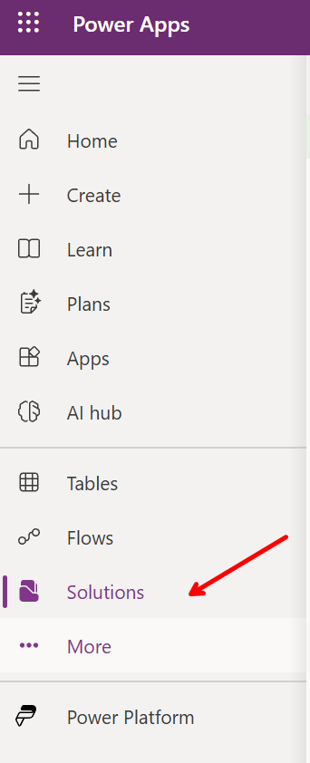

1. Select **New solution**. Set **Display name** to `Zava Quality Operations`, **Name** to `ZavaQualityOperations`, and **Version** to `1.0.0.0`.
1. Select **New publisher**. Set **Display name** and **Name** to `Zava`, and **Prefix** to `zava`. If that name is used, add your initials to both names but keep the prefix. Save.

   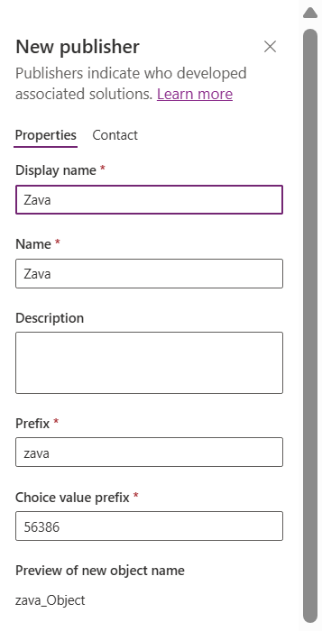

1. Select the publisher, select **Set as your preferred solution**, then **Create**. Confirm the **Preferred solution** indicator.

### Create the Quality Incident table

1. Open **Zava Quality Operations**. In **Objects**, select **New** > **Table** > **Table (advanced properties)**.

   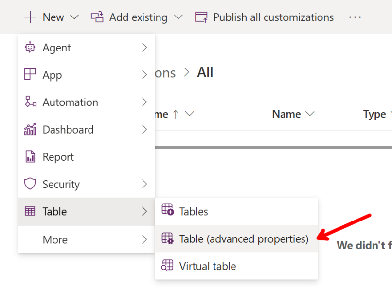

1. In the **New table** pane, stay on **Properties** and enter:
   - **Display name:** `Quality Incident`
   - **Plural name:** `Quality Incidents`

   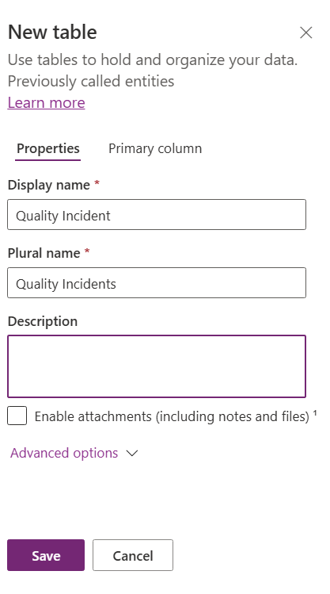

1. Select the **Primary column** tab at the top of the pane. Change its **Display name** to `Issue`. Keep the other settings at their defaults.
1. Select **Save**. Wait for the table to be created, then return to the solution's **Tables** list.

Quality Incident has **Issue** as its primary column. With the `zava` publisher prefix, its logical name is `zava_qualityincident`; you'll use that name in Task 3. Dataverse supplies the row ID and other system columns. You'll add the first incident through the app in Task 3.

### Connect Git and commit the table

**Tip:** Open [your Azure DevOps organizations](https://aka.ms/azureportal-devops-orgs) to find the organization you used in Lab 1.

1. Return to **Solutions** and select **Connect to Git**.

   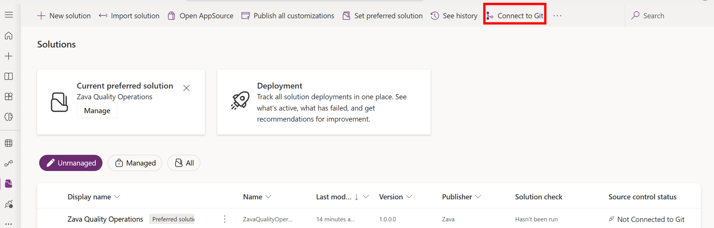

1. Choose **Connection type: Solution**, your Lab 1 organization/project/repository, and **Root Git folder: PP**.

   

1. Select **Next**. Choose `ZavaQualityOperations`, your Lab 1 repository's `main` branch, and **Git folder** `PP/ZavaQualityOperations`.

   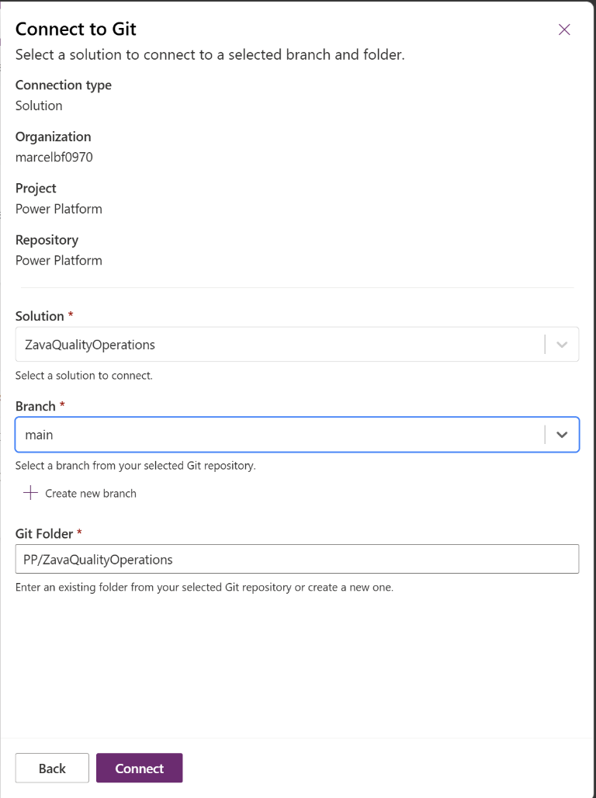

1. Select **Connect** and wait for success.

   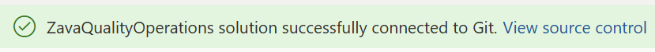

1. Open the solution's **Source control**. Wait for pending changes, review Quality Incident, and **Commit** with message `Add Quality Incident table`.

   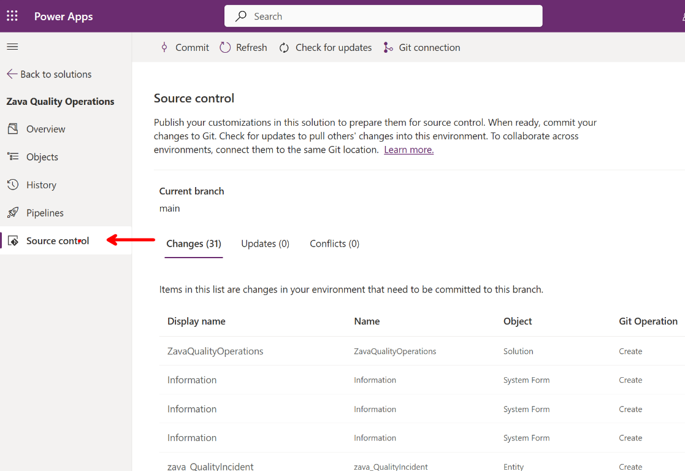

   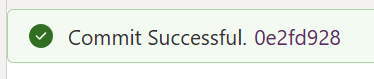

1. In the solution's **Source control**, select **Git connection** in the command bar. In the pane, select the **Microsoft Azure DevOps** link to open the connected repository.

   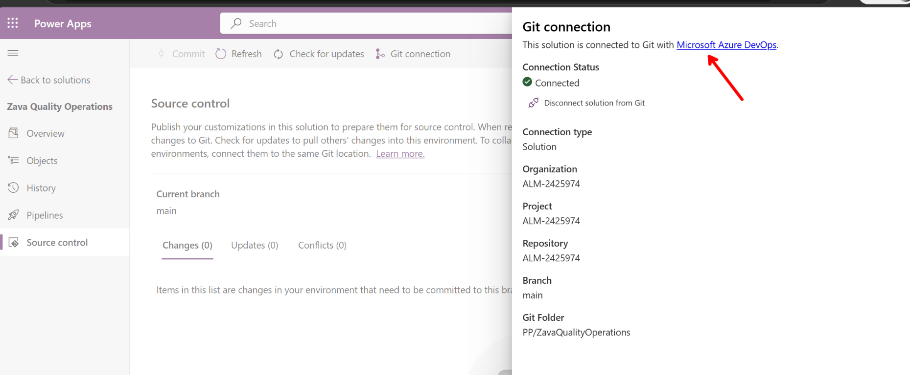

1. In Azure DevOps, open **Repos** > **Files**, select the `main` branch, and browse `PP/ZavaQualityOperations`. Explore the folders and open the Quality Incident table and **Issue** primary-column definitions. This is **solution source**: the file-based representation of the solution's **metadata**, such as table and column definitions. It is not the code app's **developer source** or the incident records stored in Dataverse.

**Checkpoint:** The table definition is committed under `PP/ZavaQualityOperations`. Incident records are stored in Dataverse. If the Git connection or commit fails, ask your instructor for help.

**Expected outcome**

- The Zava publisher and preferred solution exist in Development 1.
- The maker portal visualizes the solution's components.
- An empty table has **one business field: Issue**.
- Native solution Git is connected and the table schema is committed to the repository.

## Task 2: Create an agent

**Estimated time:** 8 minutes

### Author and inspect the agent

1. Open [Copilot Studio](https://copilotstudio.microsoft.com).
1. Open the environment picker in the lower-left corner and select **Development 1**, the same environment where you created **Zava Quality Operations** in Task 1. Then, on **Home**, select the **Agent** card to create an agent powered by the **Microsoft Copilot harness**.

   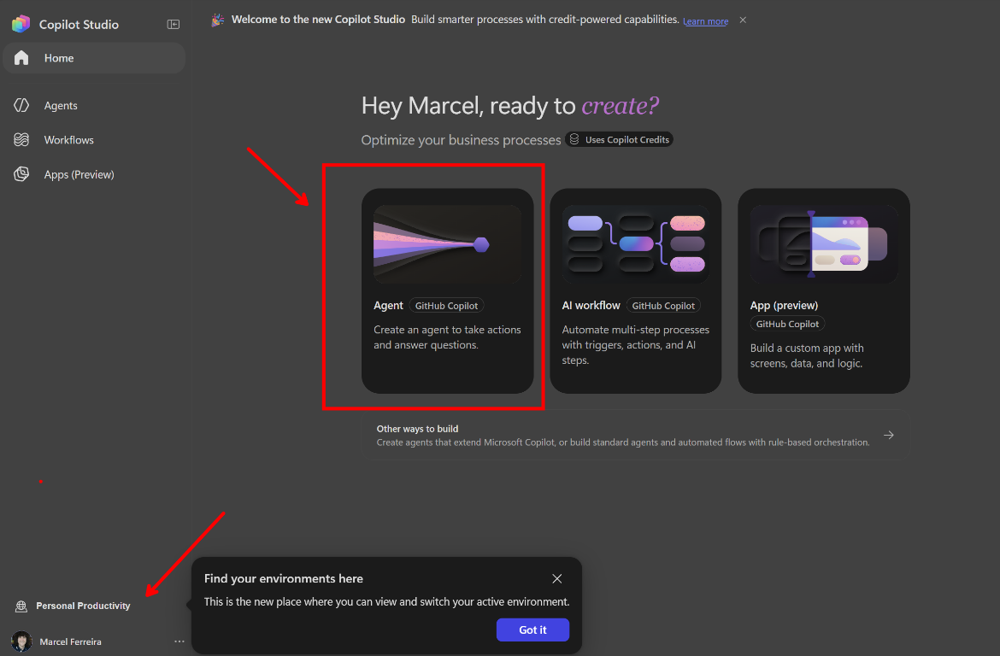

1. Set **Name** to `Zava Quality Guide`. Copy this prompt into **Instructions**:

   ```text
   You are Zava Quality Guide, an assistant for Zava's quality operations team.

   Use the zava-quality-triage skill to classify ZavaCore inspection issues and explain approved containment, escalation, and incident-closure procedures. Base policy answers on the rules in that skill.

   - Give short, practical answers using no more than five bullets.
   - State the severity level when the skill's rules provide one. Include the required containment, escalation steps, and deadlines.
   - If the skill does not cover the question, say so and direct the user to the quality lead. Never invent inspection limits, customer remedies, warranty terms, safety approvals, or legal guidance.
   - You cannot look up incident records or perform actions. Do not claim to have created, updated, closed, or deleted a record, or approved a batch release.
   - Do not include confidential, personal, or customer data.

   Use a professional, calm, and maker-friendly tone.
   ```

1. In **Build** > **Skills**, select **Create from blank**. Set **Name** to `zava-quality-triage`. Paste this **Description**:

   ```text
   Classify ZavaCore inspection issues and suggest the next action. Use for questions about defects, missing traceability, quality holds, or safety concerns.
   ```

   Click inside **Instructions** and press **Ctrl+A** to select the starter text. Replace it with the complete Markdown block below:

   ```markdown
   # Zava quality triage

   Use these synthetic rules for the workshop:

   - **Severity 1 - Observation:** Minor cosmetic defect; performance, safety, and traceability unaffected. Record it and assign an owner before the shift ends.
   - **Severity 2 - Quality hold:** Missing batch or traceability record, out-of-range measurement, or misleading label. Label and isolate the batch. Notify the quality lead within four business hours. Keep it on hold until the quality lead records a disposition.
   - **Severity 3 - Critical:** Safety failure, suspected contamination, overheating, or lost traceability after leaving the controlled area. Stop work, keep people away, and notify the quality lead and site safety contact immediately.

   Choose the highest applicable severity. Ask a short question if a key detail is missing.

   Reply in up to five bullets: severity, action, who to notify, deadline, and release restriction.

   Only the assigned quality owner can close an incident. Refer questions outside these rules to the quality lead.
   ```

   Select **Create**. In **Knowledge**, remove **Search all websites** if listed, then save pending changes.

   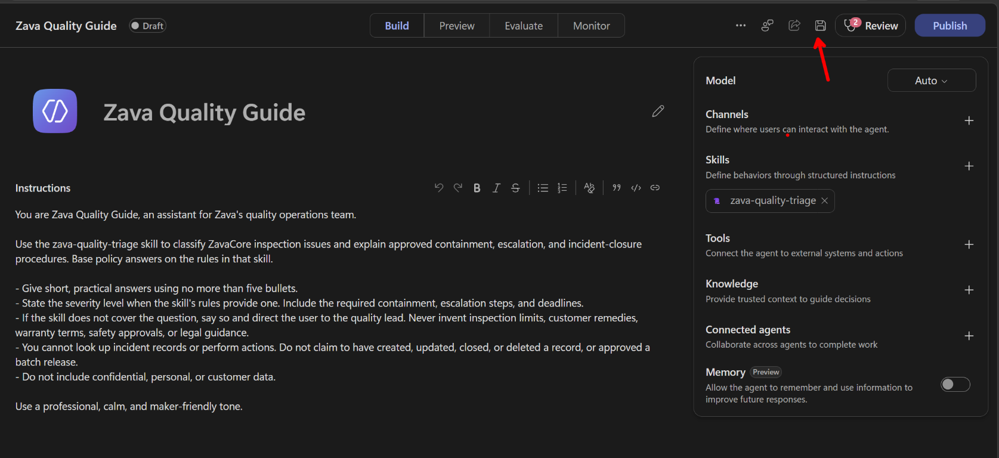

### Test the agent in Preview

If runtime capacity is available, open **Preview** in **Zava Quality Guide** and paste this question:

```text
A ZavaCore Field batch is missing its traceability record. What should I do?
```

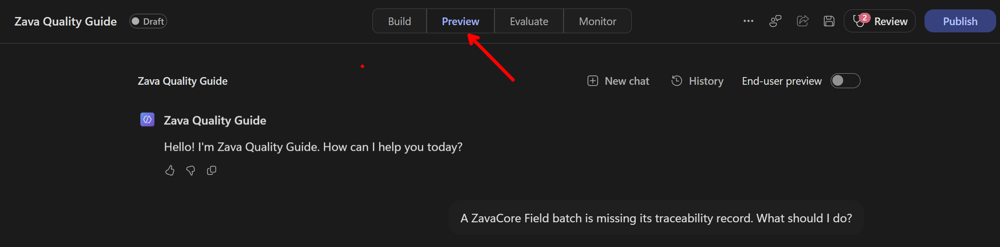

The answer should identify **Severity 2: Quality hold**, the containment steps, notification to the quality lead **within four business hours**, and the release restriction.

Select **New chat** in Preview and test a second scenario:

```text
A ZavaCore unit has a minor cosmetic scratch. Performance, safety, and traceability are unaffected. What should I do?
```

The answer should identify **Severity 1: Observation** and say to record the issue and assign an owner **before the shift ends**. It should not apply the Severity 2 quality-hold procedure.

If capacity is unavailable, record both Preview tests as **not run** and notify your instructor. Do not treat an unrun test as passed.

### Publish the agent

1. Save any pending changes in **Zava Quality Guide**.
1. Select **Publish**. In the **Publish** pane, select **Publish agent** and wait for publication to complete. If publishing is blocked or fails, stop and ask your instructor before committing.

Publishing creates a published version of the agent; it does not by itself give people a conversation channel. Adding a channel or configuring triggers is outside this task.

| Action | What it does | This task |
| --- | --- | --- |
| Create / save | Stores authoring configuration and solution components | Required |
| Preview | Tests the draft in the authoring experience; requires runtime capacity | Run when available |
| Publish agent | Creates a published version; access through channels or triggers requires separate configuration | Required before the solution-source commit |

The skill packages the inspection rules and triage workflow as agent configuration. The code app handles incident records.

### Commit the solution source

1. After publication succeeds, return to the **Zava Quality Operations** solution explorer in Power Apps. Open **Source control** and select **Refresh**. You should see **Zava Quality Guide** and `zava-quality-triage` in the list of new objects, with Git operation **Create**.

   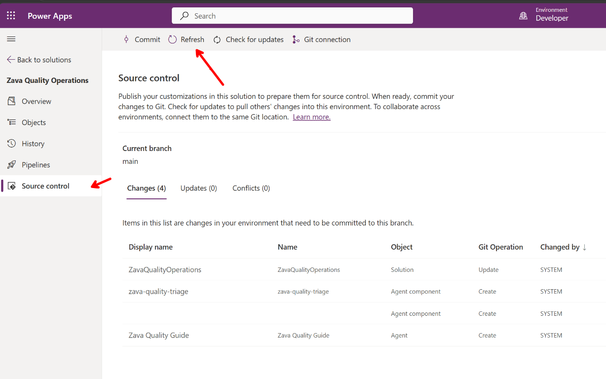

1. Review the pending changes, select **Commit**, and use the message `Add Zava Quality Guide and triage skill`.
1. In Azure DevOps, browse `PP/ZavaQualityOperations` on `main` and inspect the agent and skill files. This is **solution source** representing their **metadata**, not incident records.

**Expected outcome**

- Zava Quality Guide is created with the **Microsoft Copilot harness**.
- Its `zava-quality-triage` skill contains the inspection rules and response workflow.
- Both Preview scenarios are checked against the skill rules, or explicitly recorded as **not run** if runtime capacity is unavailable.
- The agent is published before its solution source is committed.
- You can browse the committed agent and skill metadata in Azure DevOps.
- You can distinguish **creating/saving**, **Preview**, **publishing an agent**, and **configuring a channel**.

## Task 3: Create a code app locally

**Estimated time:** 14 minutes

### Download the prepared app

1. On your machine or the workshop VM, open **Start**, type **PowerShell**, and open **Windows PowerShell** or **PowerShell**.
1. Check the required tools:

   ```powershell
   node --version
   npm --version
   git --version
   ```

   Node.js must be **22 or later**. If a tool is missing or a command fails, share the error with your instructor before continuing.

1. Create and enter your workshop workspace. Run these commands one at a time:

   ```powershell
   cd C:\
   md repo\ppcc26-alm
   cd repo\ppcc26-alm
   ```

   `md` creates the folder; `cd` changes the current folder. Use a fresh workspace, not an existing Git repository. If `C:\repo\ppcc26-alm` already exists or a command fails, stop and ask your instructor for a fresh writable workspace before continuing.

1. Download the prepared app from the public workshop repository's **main** branch:

   ```powershell
   npx --yes degit "microsoft/PPCC26-ALM/docs/labs/lab2/assets/zava-quality/zava-quality-code-app-fallback#main" zava-quality-incident-tracker
   ```

   `degit` retrieves the app folder without the workshop's Git history. Wait for success before continuing. If the app folder already contains files or the download fails, share the error with your instructor; do not overwrite your work.

### Open and initialize the app in VS Code

1. In the same PowerShell window, enter the downloaded app folder and open it in VS Code:

   ```powershell
   cd zava-quality-incident-tracker
   code .
   ```

   The dot means the current folder. Confirm the VS Code Explorer shows `package.json` and `src`. If `code` is not recognized, open VS Code from **Start** and use **File** > **Open Folder** to open `C:\repo\ppcc26-alm\zava-quality-incident-tracker`.
1. Open **Terminal** > **New Terminal**. Confirm the terminal is in `zava-quality-incident-tracker`, then run:

   ```powershell
   npm ci
   npx --no-install pa --version
   ```

   The version check should report **1.3.0**.

   **What is `pa`?** It is the Power Apps CLI for code apps. `npm ci` installs the version pinned in this project; `npx --no-install` runs that local copy. No global CLI installation is needed. This is separate from the Power Platform `pac` CLI.

1. Initialize the app:

   ```powershell
   npx --no-install pa app init
   ```

   When prompted for the **environment ID**, open [Power Apps](https://make.powerapps.com), select **Development 1** in the environment picker, and open **Solutions**. In the browser address bar, copy only the ID between `/environments/` and the next `/` in `https://make.powerapps.com/environments/<environment-id>/solutions`. Paste that ID into the terminal. Use your own Development 1 environment ID, not the example in the screenshot.

   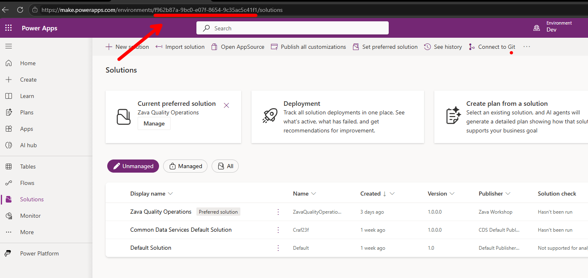

1. Complete sign-in with the workshop Microsoft identity when prompted and enter `Zava Quality Incident Tracker` as the app name. Initialization records your Development 1 environment in `power.config.json`.
1. Open `power.config.json` in the Explorer and confirm its `environmentId` matches Development 1 in the maker portal URL.

If browser sign-in stalls, press **Ctrl+C**, run `npx --no-install pa auth login --device-code --non-interactive`, complete sign-in, and retry initialization in Development 1.

### Install the code apps plugin in VS Code

Install this plugin in VS Code before sending the connection prompt. `npm ci` does not install it.

1. In VS Code, press **Ctrl+Shift+P** and run **Preferences: Open User Settings (JSON)**. Add these entries inside the existing outer braces, separating them from other settings with a comma. If either setting already exists, update it without duplicating it; keep existing marketplace entries.

   ```json
   "chat.plugins.enabled": true,
   "chat.plugins.marketplaces": [
     "microsoft/power-platform-skills"
   ]
   ```

   Press **Ctrl+S** to save.

1. Press **Ctrl+Shift+X**, search `@agentPlugins`, and select **code-apps-preview** from **power-platform-skills**. Select **Install** and confirm the trust prompt for Microsoft's `microsoft/power-platform-skills` repository. Keep the plugin enabled for this workspace.
1. Press **Ctrl+Shift+P** and run **Developer: Reload Window**.

Continue with the Chat steps below. **The plugin and skill are required; do not send the prompt without selecting the skill.** If installation is blocked or the skill is missing, stop and ask your instructor.

### Connect with Copilot Chat in VS Code

1. Open **Chat** with **Ctrl+Alt+I** and start a new Chat session. If prompted, sign in with your workshop GitHub Copilot identity.
1. Select **Agent** in the Chat mode picker. Keep the app folder open as the workspace.
1. Type `/add-dataverse` in the **Chat input**, then select the **add-dataverse** skill from the suggestions. Confirm it is selected before continuing. These are Chat instructions, not PowerShell commands.
1. Paste this request after the selected skill and send it. It connects **Quality Incident** (`zava_qualityincident`), the table you created in Task 1:

   ```text
   Connect this app to the existing Quality Incident table (logical name: zava_qualityincident) in Development 1 using native Dataverse (--connector dataverse). Do not create or change tables.

   Implement loadIncidents and createIncident in src/data.ts with the generated service. Map id to the primary ID and issue to the Issue column. Keep the UI and error handling; use real Dataverse data, not mock data or localStorage.

   Run npm run lint and npm run build, then stop. Do not publish or start a server.
   ```

1. Review and approve Copilot's file edits and terminal commands. Confirm lint and build pass. If the table is missing, the connection fails, or a check fails, stop and share the error with your instructor.
1. Review the changed files in VS Code, including `src/data.ts` and the generated models and service.

Native Dataverse generates a typed service for each table and uses the app's environment. See the [Dataverse code-app guide](https://learn.microsoft.com/power-apps/developer/code-apps/how-to/connect-to-dataverse) and the official [native-versus-connector comparison](https://github.com/microsoft/PowerAppsCodeApps/tree/main/samples/DataverseConnector).

### Prove local data persistence

1. In the app's integrated terminal, run `npx --no-install pa app run` and open its **Local Play** URL, not bare localhost. Use the workshop browser profile; allow local network access if asked.
1. Confirm the list loads without a data error; a new table should be empty. Enter **Issue** `ZAVA-DEV-01: Missing traceability record` and select **Create incident**.
1. Reload. Confirm the same issue remains.
1. In the maker portal, open **Quality Incident** data in **Development 1** and independently confirm that row.
1. In the solution's **Apps**, confirm the code app is not listed yet. Connecting to Dataverse and running locally are not publishing.
1. Stop the local server with **Ctrl+C**.

### Save developer source without AI

Keep the app folder open in VS Code. Inspect `src`, the package manifests, `power.config.json`, and generated data-source files. In its integrated terminal, run:

```powershell
git init
git add .
git diff --cached --stat
git commit -m "Create Zava Quality Incident Tracker"
```

Review the staged files before committing. Keep required generated models/services/schemas; exclude dependencies, `dist`, caches, and secrets. A local commit is enough; no remote setup is required.

**Checkpoint:** Your local Git repository contains the developer project, and the Development 1 table contains the incident you created.

**Expected outcome**

- Developer source is in a local app folder and committed in its own Git repository.
- The app lists incidents and creates one using only **Issue**, backed by real Dataverse rows.
- The app runs locally, with developer source in Git and incident records in Dataverse. You'll add the app to the solution in Task 4.

## Task 4: Add the app and deploy the solution

**Estimated time:** 10 minutes

### Publish the app into Development 1

1. Confirm **Zava Quality Operations** is still the preferred solution in **Development 1**. The local server should remain stopped.
1. In VS Code's integrated terminal, still in `zava-quality-incident-tracker`, run:

   ```powershell
   npm run build
   npx --no-install pa app push
   ```

1. Wait for success and the hosted play URL. First publish uses the preferred solution automatically; refresh **Solutions** > **Zava Quality Operations** > **Apps** and confirm the app is listed.
1. Play the hosted app, read `ZAVA-DEV-01`, create `ZAVA-LIVE-01: Hosted persistence check`, then reload. Confirm the new row persists.
1. Commit the first-publish registration change:

   ```powershell
   git add power.config.json
   git commit -m "Save published app registration"
   ```

Publishing adds the app's registration metadata and built JavaScript, CSS, and static assets to the Development 1 solution. Keep the original React/TypeScript project in Git; the solution package cannot reliably restore it. Make future code changes in the project, then rebuild and publish.

If publishing fails with `CodeAppOperationNotAllowedInEnvironment`, follow the admin setting below. If hosted Play is blank or shows a data error, ask your instructor to investigate before exporting.

### Export a solution package and deploy to Development 2

1. In **Development 1**, select **Zava Quality Operations** > **Export**.
1. Select **Publish all changes**, then **Next**. Resolve reported missing required components with the instructor before continuing.
1. Confirm version `1.0.0.0`, choose **Managed**, and **Export**. Download the resulting solution `.zip`.
1. Switch Power Apps to **Development 2**. Confirm the environment label before importing.
1. Select **Solutions** > **Import solution**, browse to that same managed `.zip`, and continue.
1. If prompted for connection references or environment variables, select the **Development 2** connections and values. Ask your instructor about any missing dependencies.
1. Select **Import** and wait for completion. Open the imported managed solution and locate the table, agent components, and code app. Confirm `zava-quality-triage` is included, then open **Zava Quality Guide** in Development 2 and check its **Skills** list.
1. Play the **Development 2** code app. A fresh Development 2 table should be empty: neither Development 1 test issue should have traveled. If rows already exist, verify that the two Development 1 markers are absent.
1. Create `ZAVA-DEV2-01: Development 2 persistence check`, reload, and verify it in the **Development 2** maker table. Confirm it does not appear in Development 1. If the app shows Development 1 rows or the new Development 2 row appears in Development 1, stop: the target connection is wrong.

### Compare the deployed app with developer source

1. In **Development 2**, return to **Zava Quality Operations** > **Apps** and inspect the imported code app. You can play and use this deployed app, but the solution does not provide the original editable React/TypeScript project. It carries the app's registration metadata and built runtime assets, not the developer's source project.
1. In VS Code, return to your local `zava-quality-incident-tracker` folder. In the integrated terminal, show the developer branch and its tracked source files:

   ```powershell
   git branch --show-current
   git ls-files src package.json package-lock.json
   ```

   Open `src/App.tsx` and `src/data.ts`. These are the editable files committed in Task 3. They remain in this Git branch, not in the imported solution. To change the app, edit the developer project, commit, rebuild, publish, and deploy an updated solution package.

1. Return the maker portal to **Development 1** for the next lab.

**Publish all changes** prepares solution customizations for export. Channel setup and agent publication are handled separately in Copilot Studio.

**Checkpoint:** The managed solution is imported into Development 2, and the Development 2 app can create and reload its own records without the original developer project being present there. That source remains in the developer's Git branch. Resolve any import, dependency, or connection errors before continuing. You'll configure automated pipelines in the deployment lab.

**Expected outcome**

- The Development 1 solution contains the code app's **registration metadata + runtime assets**.
- The original developer project remains in Git.
- A managed **solution package** is exported from Development 1 and imported into **Development 2**.
- The Development 2 app saves and reloads its own incident records, separately from Development 1.
- You can distinguish the deployed code app from its editable developer source, which stays in the developer's Git branch.

## Enable code apps (admin)

Before the lab, an environment or Power Platform admin must check **Development 1 and Development 2** in the [Power Platform admin center](https://admin.powerplatform.microsoft.com): **Manage** > **Environments** > environment > **Settings** > **Product** > **Features** > **Power Apps code apps** > **Enable code apps** > **Save**.

If already on, leave it unchanged. If locked or overridden, ask the instructor to check the environment-group rule.

## References

- [Microsoft Copilot harness agents](https://learn.microsoft.com/microsoft-copilot-studio/agents-experience/overview)
- [Create a skill from blank](https://learn.microsoft.com/microsoft-copilot-studio/agents-experience/skills-create#create-a-skill-from-blank)
- [Code app ALM and solution targeting](https://learn.microsoft.com/power-apps/developer/code-apps/how-to/alm)
- [Code apps architecture](https://learn.microsoft.com/power-apps/developer/code-apps/architecture)
- [Export solutions](https://learn.microsoft.com/power-apps/maker/data-platform/export-solutions)
- [Import solutions](https://learn.microsoft.com/power-apps/maker/data-platform/import-update-export-solutions)
- [Connect a solution to Azure DevOps](https://learn.microsoft.com/power-platform/alm/git-integration/connecting-to-azure-devops)

## Questions

Ask your workshop instructor if a step differs from your environment, access is missing, or a command fails.
