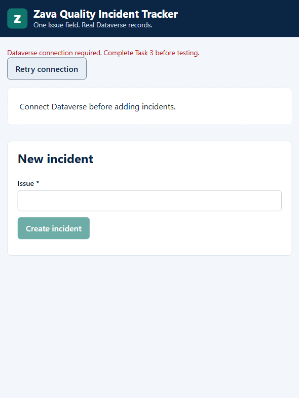

# 🧪 Lab 2: Inner-loop ALM with Zava Quality Operations

**Owner:** Marcel Ferreira · **Last updated:** 2026-10-19 · **Status:** Draft

Create a solution, author an agent, work with a local code app, then publish the app and deploy a solution package to **UAT**.

## Lab outline

Before each task, your instructor shows a **task / estimated time** slide followed by an **expected outcome** slide.

| Activity | Estimated time |
| --- | ---: |
| Introduce the solution abstraction | 3 minutes |
| Task 1: Create a solution | 10 minutes |
| Task 2: Create an agent | 8 minutes |
| Task 3: Create a code app locally | 14 minutes |
| Task 4: Add the app and deploy the solution | 10 minutes |
| **Total, excluding the workshop break** | **45 minutes** |

These are planning estimates, including briefings, not a validated attendee completion time.

## Three representations of ALM assets

| Term | Meaning | Where you see it |
| --- | --- | --- |
| **Solution package** | Exported `.zip` containing component metadata and runtime assets for deployment | Export/import and deployment pipelines |
| **Solution source** | File-based solution representation for supported components | Native solution Git integration or extracted solution files |
| **Developer source** | Editable code project, dependencies, configuration, and tests where present | Local project and its own Git repository |

The **solution in Dev** is the live container visualized by the maker portal, not an exported `.zip`. **Metadata** describes components; **runtime assets** are built content such as JavaScript, CSS, and static assets. A `.zip` is a package format, not a synonym for compiled code.

Native solution Git supports specific component types. Code apps do not currently support that integration: keep their developer source in a separate Git repository. A solution package cannot reliably recreate the original developer project, modules, comments, tests, or build setup.

## Prerequisites

- **Dev** and **UAT** from Lab 1, with Dataverse, Managed Environments, and [code apps enabled](#enable-code-apps-admin) in both. UAT is this workshop's test target, not Production.
- **Environment Maker** and **Dataverse System Administrator** access in both environments; the instructor has checked UAT dependencies and that no conflicting unmanaged Zava copy exists.
- Copilot Studio's **Microsoft Copilot harness** and uploaded-file knowledge available in Dev. Preview or channel publishing also requires the relevant runtime capacity and permissions.
- Lab 1's Azure DevOps repository, in the same Microsoft Entra tenant as Dev, with Basic access and contribution permission.
- Workshop VM with Node.js 22 or later, Git with an author identity configured, GitHub Copilot CLI, and the Power Apps code apps plugin installed.
- A downloaded local workshop repository and the workshop Microsoft and GitHub identities. Use only the synthetic records below.

The prepared app is the default: **no AI-generated UI, table, Git commits, or deployment commands**. Use one bounded AI-assisted step to connect its generated Dataverse service.

## Task 1: Create a solution

**Estimated time:** 10 minutes

**Expected outcome**

- The Zava publisher and preferred solution exist in Dev.
- The maker portal visualizes the solution's components.
- An empty table has **one business field: Issue**.
- Native solution Git is connected and the table schema is committed to the repository.

### Create the solution and publisher

1. Open [Power Apps](https://make.powerapps.com), select **Dev**, then **Solutions**.

   

   

1. Select **New solution**. Set **Display name** to `Zava Quality Operations`, **Name** to `ZavaQualityOperations`, and **Version** to `1.0.0.0`.
1. Select **New publisher**. Set **Display name** and **Name** to `Zava`, and **Prefix** to `zava`. If that name is used, add your initials to both names but keep the prefix. Save.

   

1. Select the publisher, select **Set as your preferred solution**, then **Create**. Confirm the **Preferred solution** indicator.

### Create a one-business-field table

1. Open **Zava Quality Operations** > **Objects** > **New** > **Table** > **Table (advanced properties)**. If needed, open **More commands**.
1. Set **Display name** to `Quality Incident` and **Plural name** to `Quality Incidents`.

   

1. On **Primary column**, change **Display name** to `Issue`, then **Save**. Leave the other settings unchanged.
1. Do **not** add Batch ID, Product, or Incident status columns. Dataverse automatically creates system columns such as the row ID; "one field" means one business field, not one physical database column.
1. In the table's **Properties** > **Advanced options**, copy its **Logical name** for Task 3. Leave the table empty.

Renaming the primary column's display name to Issue does not necessarily change its logical name. No table search or indexing is needed: the agent does not access this table.

### Connect Git and commit the table

1. Return to **Solutions** and select **Connect to Git**.

   

1. Choose **Connection type: Solution**, your Lab 1 organization/project/repository, and **Root Git folder: PP**.

   

1. Select **Next**. Choose `ZavaQualityOperations`, the repository's existing `main` branch, and **Git folder** `PP/ZavaQualityOperations`. This is the attendee's Lab 1 repository, not the workshop-content repository.

   

1. Select **Connect** and wait for success.

   

1. Open the solution's **Source control**. Wait for pending changes, review Quality Incident, and **Commit** with message `Add Quality Incident table`.

   

   

1. In Azure DevOps, browse `PP/ZavaQualityOperations`. Find the table and primary-column definitions.

**Checkpoint:** This is **solution source**: schema, not incident rows. No solution package has been exported. If Git reports an error or no organization is available, ask the instructor; do not create another organization.

## Task 2: Create an agent

**Estimated time:** 8 minutes

**Expected outcome**

- Zava Quality Guide is created with the **Microsoft Copilot harness**.
- You can browse its components in the preferred solution and save its supported solution source.
- You can explain **creating/saving an agent** versus **publishing it to a channel**.

### Author and inspect the agent

1. Open [Copilot Studio](https://copilotstudio.microsoft.com) in **Dev** and create an agent powered by the **Microsoft Copilot harness**.
1. Set **Name** to `Zava Quality Guide`. Paste the [agent prompt](https://github.com/microsoft/PPCC26-ALM/blob/main/docs/labs/lab2/assets/zava-quality/zava-quality-agent-prompt.md) box into **Instructions**.

   

   This attributed [Microsoft Learn example](https://learn.microsoft.com/microsoft-copilot-studio/agents-experience/overview) may show the previous name, **GitHub Copilot harness**. The change is naming only. **GitHub Copilot CLI** in Task 3 is a separate tool.

1. Remove **Search all websites** if listed. Download the [inspection guide](https://github.com/microsoft/PPCC26-ALM/blob/main/docs/labs/lab2/assets/zava-quality/zava-quality-inspection-guide.md) with **Download raw file**, upload it under **Knowledge**, and wait for **Ready**. Save pending changes.
1. Return to Power Apps > **Zava Quality Operations**, refresh, and browse **Zava Quality Guide** and its related components. The preferred solution routes these solution-aware components into this container.
1. If missing, use **Add existing** > **Agent** > **Agent**, select it, and include required objects. If unavailable, ask the instructor; do not substitute a different harness.
1. Open **Source control**, review and commit with message `Add Zava Quality Guide`. Inspect the supported configuration in Azure DevOps.

If runtime capacity is available, use **Preview** to ask: `A ZavaCore Field batch is missing its traceability record. What should I do?` The answer should follow the uploaded policy. If capacity is unavailable, record the answer test as **not run**; creating the agent is not evidence of answer quality.

### Creating is not publishing

| Action | What it does | This task |
| --- | --- | --- |
| Create / save | Stores authoring configuration and solution components | Required |
| Preview | Tests the draft in the authoring experience; requires runtime capacity | Run when available |
| Publish agent | Makes a published version available to configured channels, subject to access, licensing, and channel setup | Explain; not required here |

The agent explains policy; it does not create or retrieve incident rows. A source commit or **Ready** knowledge indicator is not an agent publication or an answer-quality pass.

## Task 3: Create a code app locally

**Estimated time:** 14 minutes

**Expected outcome**

- Developer source exists on your machine and is committed in its own local Git repository.
- The app lists incidents and creates one using only **Issue**, backed by real Dataverse rows.
- The code app is **not in the solution yet**. Neither its original developer project nor business rows are solution content.

### Copy and initialize the prepared project

1. From your downloaded workshop repository, copy the entire folder `docs/labs/lab2/assets/zava-quality/zava-quality-code-app-fallback` into **Documents**. Name the copy `zava-quality-incident-tracker`. The legacy folder name says "fallback"; it is now the default prepared project.
1. Right-click the copy and select **Open in Terminal**. Run:

   ```powershell
   npm ci
   npx --no-install pa app init
   ```

1. Sign in with the workshop Microsoft identity, choose **Dev**, and enter `Zava Quality Incident Tracker`. Initialization records the environment in `power.config.json`; it does not publish.

If browser sign-in stalls, press **Ctrl+C**, run `npx --no-install pa auth login --device-code --non-interactive`, complete sign-in, and retry initialization. Do not substitute the default environment.



This is the prepared project's initial, unconnected state, not a completed Local Play check.

### Connect once with Copilot

Start `copilot`, invoke `/code-apps-preview:add-dataverse`, and paste the following with your table's actual logical name:

```text
Connect this prepared code app to the existing Dataverse table <table-logical-name>. Do not scaffold a new app or create or extend tables. Use the Power Apps CLI to generate its Dataverse models and service.

Implement loadIncidents and createIncident in src/data.ts using that generated service. The app contract is Incident { id: string, issue: string } and NewIncident { issue: string }. Map id to the actual primary ID and issue to the actual primary-name column, whose display name is Issue. Read the generated schema; do not assume the logical name is zava_issue. Do not add Batch ID, Product, status fields, filters, or other features.

Read and create real rows, including the empty-table case. Check service failures explicitly and propagate their errors; do not convert failed reads to empty lists or report an unsaved incident as saved. Do not use mock data, localStorage, or direct fetch/axios calls. Keep the existing one-field UI. Build with npm run build and stop. Do not start a server, publish, or change Git history.
```

When the build succeeds, enter `/exit`. This is the single AI-assisted implementation step. If it fails, ask the instructor to inspect the table logical name, generated schema, and error; do not invent a successful connection.

### Prove local data persistence

1. Run `npx --no-install pa app run` and open its **Local Play** URL, not bare localhost. Use the workshop browser profile; allow local network access if asked.
1. Confirm an empty list without a data error. Enter **Issue** `ZAVA-DEV-01: Missing traceability record` and select **Create incident**.
1. Reload. Confirm the same issue remains.
1. In the maker portal, open **Quality Incident** data in **Dev** and independently confirm that row.
1. In the solution's **Apps**, confirm the code app is not listed yet. Connecting to Dataverse and running locally are not publishing.
1. Stop the local server with **Ctrl+C**.

### Save developer source without AI

Open the copied project in Visual Studio Code. Inspect `src`, the package manifests, `power.config.json`, and generated data-source files. Then run:

```powershell
git init
git add .
git diff --cached --stat
git commit -m "Create Zava Quality Incident Tracker"
```

Review the staged files before committing. Keep required generated models/services/schemas; exclude dependencies, `dist`, caches, and secrets. A local commit is enough; no remote setup is required.

**Checkpoint:** The developer project is outside the solution. The incident row is real data in Dev, not an item transported by a solution package.

## Task 4: Add the app and deploy the solution

**Estimated time:** 10 minutes

**Expected outcome**

- The code app is in the solution as **registration metadata + runtime assets**, not original developer source.
- A managed **solution package** is exported from Dev and imported into **UAT**.
- You verify UAT membership and runtime/data separation rather than treating publish or import success alone as a runtime pass.
- You can explain why unpacking a solution cannot recreate the authoritative original source project.

### Publish the app into Dev

1. Confirm **Zava Quality Operations** is still the preferred solution in **Dev**. The local server should remain stopped.
1. From the app folder, run:

   ```powershell
   npm run build
   npx --no-install pa app push
   ```

1. Wait for success and the hosted play URL. First publish uses the preferred solution automatically; refresh **Solutions** > **Zava Quality Operations** > **Apps** and confirm the app is listed.
1. Play the hosted app, read `ZAVA-DEV-01`, create `ZAVA-LIVE-01: Hosted persistence check`, then reload. Confirm the new row persists.
1. Commit the first-publish registration change:

   ```powershell
   git add power.config.json
   git commit -m "Save published app registration"
   ```

The solution receives app registration metadata and built JavaScript/CSS/static assets. The original React/TypeScript project stays in developer-source Git. Do not edit generated bundles or rely on unpacking them to recover the original project.

If publishing fails with `CodeAppOperationNotAllowedInEnvironment`, follow the admin setting below. Blank hosted Play or a data error is a failed runtime check, even when publishing succeeded; ask the instructor rather than regenerating the app or switching environments.

### Export a solution package and deploy to UAT

1. In **Dev**, select **Zava Quality Operations** > **Export**.
1. Select **Publish all changes**, then **Next**. Resolve reported missing required components with the instructor before continuing.
1. Confirm version `1.0.0.0`, choose **Managed**, and **Export**. Download the resulting solution `.zip`.
1. Switch Power Apps to **UAT**. Confirm the environment label before importing.
1. Select **Solutions** > **Import solution**, browse to that same managed `.zip`, and continue.
1. If prompted for connection references or environment variables, select the **UAT** connections and values, not Dev. Ask the instructor about missing dependencies; do not delete solutions or bypass errors.
1. Select **Import** and wait for completion. Open the imported managed solution; locate the table, agent components, and code app. This is deployment to another environment, not another `pa app push` from your Dev project.
1. Play the **UAT** code app. A fresh UAT table should be empty: neither Dev test issue should have traveled. If rows already exist, verify that the two Dev markers are absent.
1. Create `ZAVA-UAT-01: UAT persistence check`, reload, and verify it in the **UAT** maker table. Confirm it does not appear in Dev. If the app shows Dev rows or the new UAT row appears in Dev, stop: the target connection is wrong.
1. Return the maker portal to **Dev** for the next lab.

**Publish all changes** publishes solution customizations for export. It is not Copilot Studio's **Publish agent** action and does not establish channel availability. Channel setup/publication and agent runtime permissions must be handled separately.

**Checkpoint:** A successful import proves package transport, not every runtime behavior. Record deployment and UAT runtime results separately; pending imports, missing agent dependencies, blank Play, or failed CRUD are not completion. Automated pipeline setup remains in the deployment lab.

## Enable code apps (admin)

Before the lab, an environment or Power Platform admin must check **Dev and UAT** in the [Power Platform admin center](https://admin.powerplatform.microsoft.com): **Manage** > **Environments** > environment > **Settings** > **Product** > **Features** > **Power Apps code apps** > **Enable code apps** > **Save**.

If already on, leave it unchanged. If locked or overridden, ask the instructor to check the environment-group rule.

## References

- [Microsoft Copilot harness agents](https://learn.microsoft.com/microsoft-copilot-studio/agents-experience/overview)
- [Code app ALM and solution targeting](https://learn.microsoft.com/power-apps/developer/code-apps/how-to/alm)
- [Code apps architecture](https://learn.microsoft.com/power-apps/developer/code-apps/architecture)
- [Export solutions](https://learn.microsoft.com/power-apps/maker/data-platform/export-solutions)
- [Import solutions](https://learn.microsoft.com/power-apps/maker/data-platform/import-update-export-solutions)
- [Connect a solution to Azure DevOps](https://learn.microsoft.com/power-platform/alm/git-integration/connecting-to-azure-devops)

## Questions

Ask your workshop instructor if a step differs from your environment or a command fails. Do not silently substitute mock data, another harness, another environment, or a failed runtime result.
