# 🧪 Lab 2: Building Power Platform Solutions

The inner loop is where makers and developers spend most of their time: building, testing, and iterating. A Power Platform solution provides a common application lifecycle management (ALM) and deployment boundary, but it is not always the editable source.

For maker-authored components, the solution contains the component definitions that the maker edits. For code-first components, such as code apps, the editable project stays in a Git repository and the solution contains the built runtime artifacts and platform metadata needed for deployment.

This lab explores both models. You will work with solution metadata and Git integration, collaborate across development environments, and then build a Copilot Studio agent and a Power Apps code app in one Zava Quality Operations solution.

✅ Lab tasks

In this lab, you will go through the following tasks:

1. [Import and commit a solution in your dev environment](#-task-1-import-and-commit-a-solution-in-your-dev-environment)
1. [Edit your solution](#️-task-2-edit-your-solution)
1. [Work as a team in multiple environments](#-task-3-work-as-a-team-in-multiple-environments)
1. [Build Zava Quality Operations with an agent and code app](#-task-4-build-zava-quality-operations-with-an-agent-and-code-app)

## 💻 Know where your source lives

For low-code makers, a solution contains the editable definitions of components such as tables, flows, and canvas apps. For professional developers, a solution can also contain compiled runtime artifacts produced from source projects that live outside Power Platform.

The solution remains the common unit for dependencies, export, import, and deployment. The source of truth depends on the type of component.

## 📦 Understanding Solution Abstractions

The term "source" can be confusing because ALM involves three related artifacts:

### Three Related ALM Artifacts

1. **Developer-authored source**
   - React, TypeScript, C#, tests, package manifests, and build configuration
   - Maintained in a normal Git repository
   - Used to produce deployable runtime artifacts

1. **Unpacked solution**
   - Collection of individual files: `.msapp`, `.xml`, `.js`, `.dll` files
   - Includes solution metadata and the runtime artifacts packaged for Power Platform
   - Can represent maker-authored components in source control, but does not reconstruct an original code-first project

1. **Solution package (`.zip`)**
   - Compressed deployment package containing metadata and runtime artifacts
   - Used to move the solution between environments
   - Produced for deployment, not used as the primary authoring format

> **Note:** It's not possible to generate traditional source code from runtime artifacts in a solution. Traditional source code must be maintained in a repository by the developer as part of their development workflow.

**Key insight:** The solution is the shared deployment boundary. Power Platform Git Integration can manage supported solution components, while traditional source code stays in its own project and is built before its runtime artifacts are added to the solution. Power Apps code apps currently do not expose their original React or TypeScript projects through Power Platform Git Integration.

---

## 📋 Prerequisites

To complete this lab, you need to have the following environments and resources configured:

### Environments

| Environment Name | Environment Type | Purpose |
|---|---|---|
| Dev | Development | Primary development environment for creating and testing solutions |
| HotFix | Development | Secondary environment for hotfix development and multi-environment testing |

### Repository

- **Azure DevOps Repository**: You need an Azure DevOps repository configured with Git integration enabled. This repository will store your solution's unpacked metadata files and enable version control collaboration.

---

## 📥 Task 1: Import and commit a solution in your dev environment

In this task, we will work with the **Solution binary package** (.zip format) as defined earlier in our abstractions. This is the packaged format used for importing and exporting solutions between Power Platform environments.

### Step 1: Import the solution into Power Apps

1. **Navigate to the Power Apps maker portal**
   - Go to [make.powerapps.com](https://make.powerapps.com)
   - Select the environment "Dev"

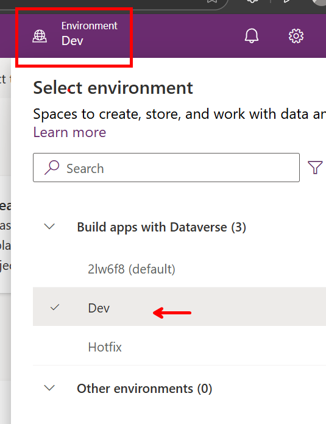

1. **Access the solution import feature**
   - In the left navigation, click on **Solutions**

   

   - Click **Import solution** at the top of the page

1. **Upload the solution file**
   - Download the solution [ContosoRealEstate](assets/ContosoRealEstate_1_0_0_2.zip) available in the assets folder of this repo.
   - Click **Choose File** or **Browse**
   - Navigate to the `assets` folder in this repository
   - Select the solution `.zip` file provided for this lab
   - Click **Next**

1. **Configure import settings**
   - Review the solution information
   - Click **Import**

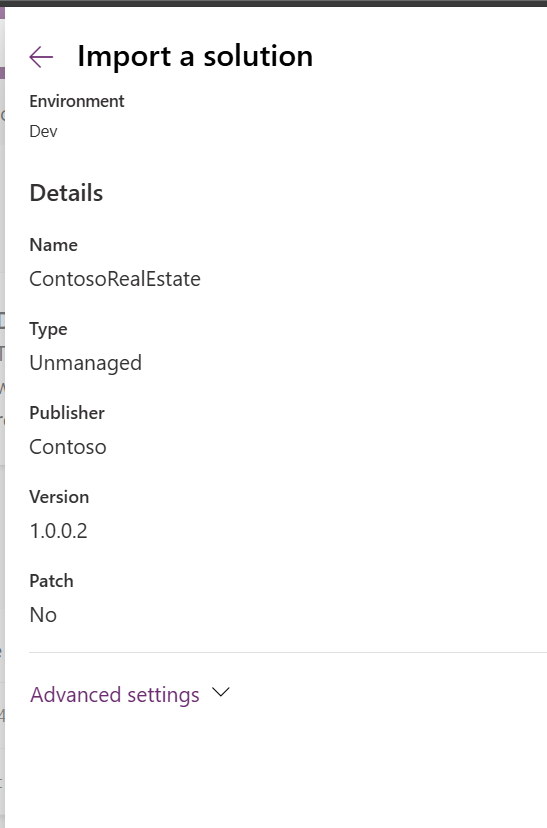

1. **Wait for import completion**
   - Monitor the import progress

   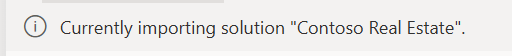

   - Verify the solution appears in your Solutions list

   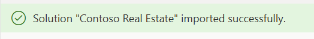

1. **Publish all customizations**
   - After the solution import completes, open the Solution **Contoso Real Estate**
   - Select **Publish all customizations**
   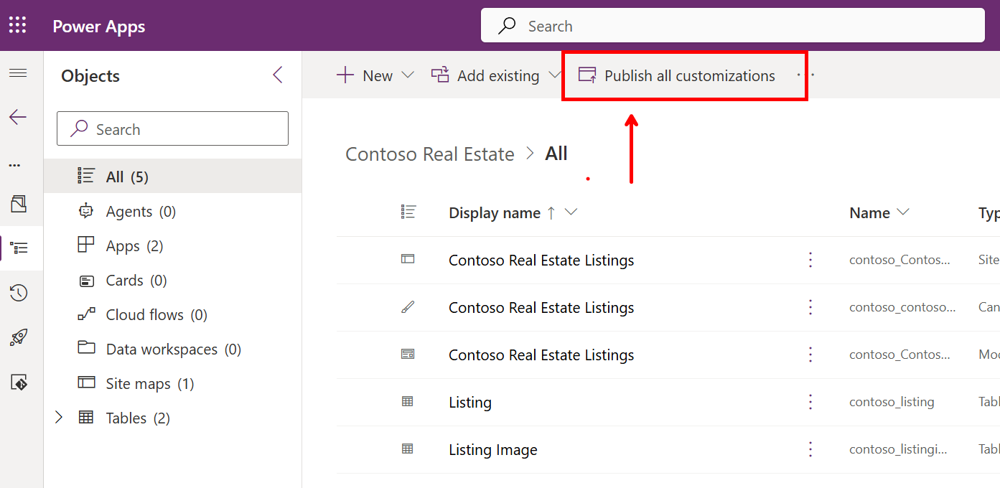
   - Wait for the publish process to complete
   - This ensures all components in the solution are published and ready to use

1. **Import configuration data (optional)**
   > note: This step requires [Power Platform CLI](https://learn.microsoft.com/power-platform/developer/cli/reference/data) installed in a windows machine.

The Contoso Real Estate solution contains the schema and components (tables, apps, flows) but does not include sample data. If you would like to populate your environment with configuration data for testing purposes, you can import the data using PAC CLI.

To import the [data](assets/ContosoRealEstateData.zip), you can use either:

```powershell
pac data import -d [file]
```

or use the Configuration Migration Tool:

```powershell
pac tool CMT
```

### Step 2: Commit the solution using Power Platform Git integration

1. **Enable Git integration** (if not already configured)
   - In the Solutions area, click Connect to Git

   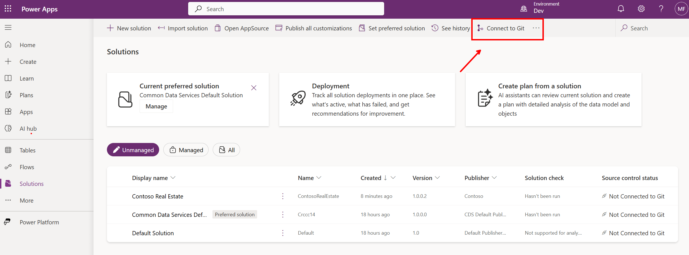

   - Connect to your Azure DevOps Organization. In the dialog, select:
     - Connection type: *Solution*
     - Organization: Select the available
     - Project: Select an available project
     - Repository: select an available Repository
     - Root Git folder: PP

     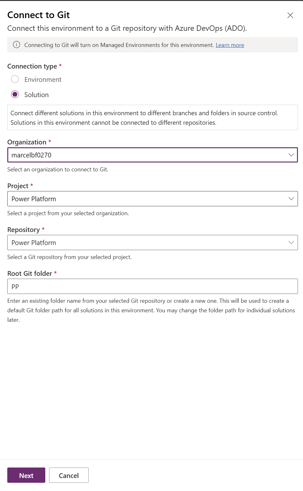

     Note: if you don't have an organization to select you must create an Azure DevOps Organization.

   - Connect to your repository and branch. In the dialog, select:
     - Solution: ContosoRealEstate
     - Branch: Main
     - Git folder: PP/ContosoRealEstate
     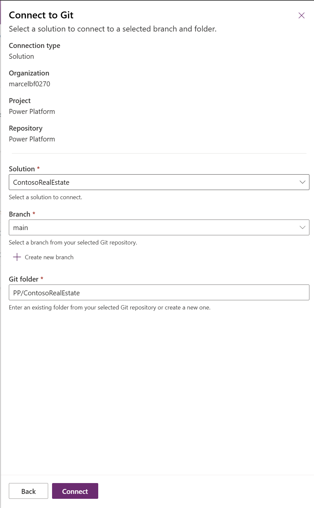
   - Click Connect

You are now connect to your GIT repository!

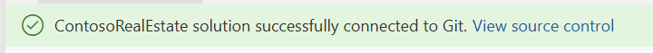

1. **Commit the solution to source control**
   - In **Solution explorer**, open the solution **Contoso Real Estate**
   - Go to **Source control** tab in your solution
   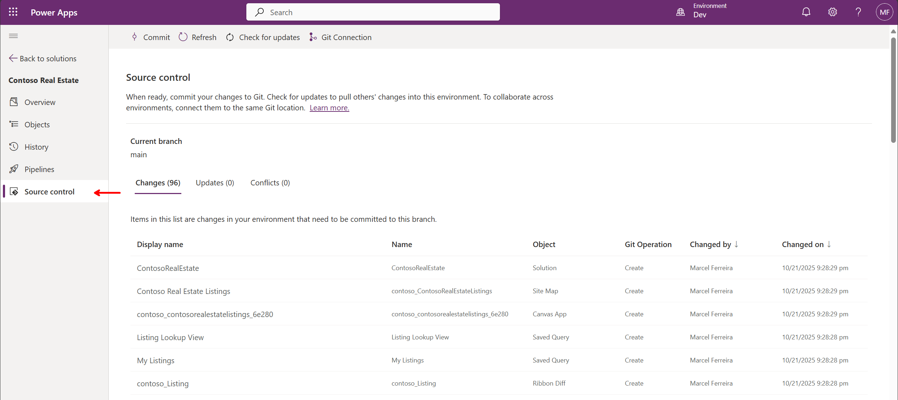
      > **Important:** After setting up Git integration, all the source control components will be processed in the background. During this time, the commit functionality will be disabled. Wait until this process completes before attempting to commit. You'll know it's ready when the commit button becomes active.
      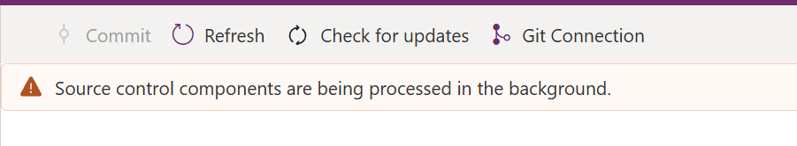
   - Click **Commit** in the ribbon
   - Add a commit message: "Initial commit of Contoso Real Estate Solution"
   - Click **Commit** to save the solution to your Git repository

   

1. **Verify the commit**
   - Check your Git repository to confirm the solution files were committed
   - Review the folder structure created by the Power Platform Git integration

> **Expected outcome:** Your solution is now imported into your development environment and committed to source control as an unpacked solution format.

---

## ✏️ Task 2: Edit your solution

In this task, we will work with the **Solution Explorer** in the Power Apps maker portal as our reference for source code. You'll learn how changes flow between the maker portal and your Git repository, including how to handle conflicts.

### Step 1: Edit the Canvas App with YAML code

1. **Open the Canvas App from Solution Explorer**
   - Open the solution **Contoso Real Estate**
   - In the Objects, click the Contoso Real Estate Canvas App to edit the canvas app.
   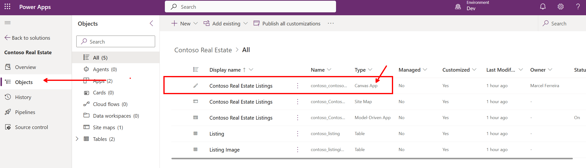
   - You are now in Power Apps Studio

1. **Import YAML code snippet**

- Copy the YAML code bellow (or [copy YAML file from GitHub](https://github.com/microsoft/PPCC25-ALM/blob/main/docs/labs/lab2/assets/screens.pa.yaml))

```yaml
Screens:
  scrALM:
    Children:
      - ScreenContainer4:
          Control: GroupContainer@1.3.0
          Variant: AutoLayout
          Properties:
            Fill: =RGBA(245, 245, 245, 1)
            Height: =Parent.Height
            LayoutAlignItems: =LayoutAlignItems.Stretch
            LayoutDirection: =LayoutDirection.Vertical
            LayoutGap: =16
            PaddingBottom: =16
            PaddingLeft: =16
            PaddingRight: =16
            PaddingTop: =16
            Width: =Parent.Width
          Children:
            - MainContainer3:
                Control: GroupContainer@1.3.0
                Variant: AutoLayout
                Properties:
                  Fill: =RGBA(255, 255, 255, 1)
                  LayoutDirection: =LayoutDirection.Vertical
                  RadiusBottomLeft: =8
                  RadiusBottomRight: =8
                  RadiusTopLeft: =8
                  RadiusTopRight: =8
                Children:
                  - LinkCanvas1:
                      Control: Link@0.0.45
                      Properties:
                        Align: =Align.Center
                        AlignInContainer: =AlignInContainer.Stretch
                        Appearance: ='LinkCanvas.Appearance'.Default
                        AutoHeight: =true
                        FillPortions: =1
                        FontSize: =52
                        LayoutMinHeight: =72
                        Text: ="aka.ms/PPCC25-ALM"
                        URL: ="https://aka.ms/PPCC25-ALM"
                        VerticalAlign: =VerticalAlign.Middle
  scrCommunityYAML:
    Children:
      - ScreenContainer3:
          Control: GroupContainer@1.3.0
          Variant: AutoLayout
          Properties:
            Fill: =RGBA(245, 245, 245, 1)
            Height: =Parent.Height
            LayoutAlignItems: =LayoutAlignItems.Stretch
            LayoutDirection: =LayoutDirection.Vertical
            LayoutGap: =16
            PaddingBottom: =16
            PaddingLeft: =16
            PaddingRight: =16
            PaddingTop: =16
            Width: =Parent.Width
          Children:
            - HeaderContainer2:
                Control: GroupContainer@1.3.0
                Variant: AutoLayout
                Properties:
                  Fill: =RGBA(255, 255, 255, 1)
                  FillPortions: =0
                  Height: =75
                  LayoutDirection: =LayoutDirection.Horizontal
                  RadiusBottomLeft: =8
                  RadiusBottomRight: =8
                  RadiusTopLeft: =8
                  RadiusTopRight: =8
                Children:
                  - TextCanvas3_2:
                      Control: Text@0.0.51
                      Properties:
                        Height: =40
                        Size: =24
                        Text: "=If(\n        Hour(Now()) >= 6 && Hour(Now()) < 12, \"\U0001F324️  Good Morning, \",\n        Hour(Now()) >= 12 && Hour(Now()) < 18, \"☀️  Good Afternoon, \",\n        \"\U0001F319  Good Night, \")\n & Left(User().FullName, Find(\" \", User().FullName) - 1)\n "
                        Weight: ='TextCanvas.Weight'.Semibold
                        Width: =500
            - MainContainer2:
                Control: GroupContainer@1.3.0
                Variant: AutoLayout
                Properties:
                  Fill: =RGBA(255, 255, 255, 1)
                  LayoutDirection: =LayoutDirection.Vertical
                  RadiusBottomLeft: =8
                  RadiusBottomRight: =8
                  RadiusTopLeft: =8
                  RadiusTopRight: =8
                Children:
                  - LoaingImage:
                      Control: Image@2.2.3
                      Properties:
                        DisplayMode: =DisplayMode.View
                        Fill: =RGBA(56, 96, 178, 0.1)
                        Height: =Parent.Height
                        Image: |
                          =$"data:image/svg+xml;utf-8, {EncodeUrl("<svg xmlns='http://www.w3.org/2000/svg' width='100%' height='100%' viewBox='0 0 100 100'>

                          <style>
                              .loading-text {
                                  font-family: Arial, sans-serif;
                                  font-size: 5px;
                                  font-weight: bold;
                                  fill: red;
                                  text-anchor: middle;
                              }
                              .spinner {
                                  animation: rotate 2s linear infinite;
                                  transform-origin: 50px 50px;
                              }
                              @keyframes rotate {
                                  0% { transform: rotate(0deg); }
                                  100% { transform: rotate(360deg); }
                              }
                              .track {
                                  fill: none;
                                  stroke: #ccc;
                                  stroke-width: 3;
                              }
                              .circle {
                                  fill: none;
                                  stroke: #010069;
                                  stroke-width: 3;
                                  stroke-linecap: round;
                                  stroke-dasharray: 45, 100;
                                  stroke-dashoffset: 0;
                                  animation: dash 1.5s ease-in-out infinite;
                              }
                              @keyframes dash {
                                  0% { stroke-dasharray: 1, 100; stroke-dashoffset: 0; }
                                  50% { stroke-dasharray: 45, 100; stroke-dashoffset: -25; }
                                  100% { stroke-dasharray: 45, 100; stroke-dashoffset: -75; }
                              }
                          </style>

                          <!-- Bold red loading text ABOVE the circle -->
                          <text x='50' y='25' class='loading-text'>Loading, please wait</text>

                          <!-- Smaller static circle track -->
                          <circle class='track' cx='50' cy='50' r='15'></circle>

                          <!-- Smaller spinning progress circle -->
                          <g class='spinner'>
                              <circle class='circle' cx='50' cy='50' r='15'></circle>
                          </g>

                          </svg>")}"
                        Transparency: =
                        Width: =Parent.Width
            - FooterContainer1:
                Control: GroupContainer@1.3.0
                Variant: AutoLayout
                Properties:
                  Fill: =RGBA(255, 255, 255, 1)
                  FillPortions: =0
                  Height: =75
                  LayoutDirection: =LayoutDirection.Horizontal
                  RadiusBottomLeft: =8
                  RadiusBottomRight: =8
                  RadiusTopLeft: =8
                  RadiusTopRight: =8
                Children:
                  - cntCurrentTime:
                      Control: GroupContainer@1.3.0
                      Variant: ManualLayout
                      Properties:
                        DropShadow: =DropShadow.None
                        Height: =97
                        RadiusBottomLeft: =0
                        RadiusBottomRight: =0
                        RadiusTopLeft: =0
                        RadiusTopRight: =0
                        Width: =333
                        X: =363
                        Y: =318
                      Children:
                        - lblCurrentTime:
                            Control: Label@2.5.1
                            Properties:
                              Align: =Align.Center
                              Color: =RGBA(9, 33, 98, 1)
                              FontWeight: =FontWeight.Semibold
                              Height: =Parent.Height
                              Size: =19
                              Text: |
                                ="Current Time: " & Text(nowTime, "h:mm AM/PM", "en-US")
                              Width: =Parent.Width
                        - tmrCurrentTime:
                            Control: Timer@2.1.0
                            Properties:
                              AutoPause: =false
                              AutoStart: =true
                              Duration: =1000
                              OnTimerStart: =Set(nowTime, Now())
                              Repeat: =true
                              Visible: =false
```

- Select any screen to paste the YAML snippet.
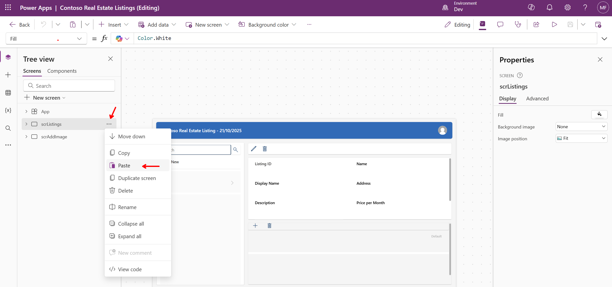

- Two new screens should be added. scrALM and scrCommunityYAML
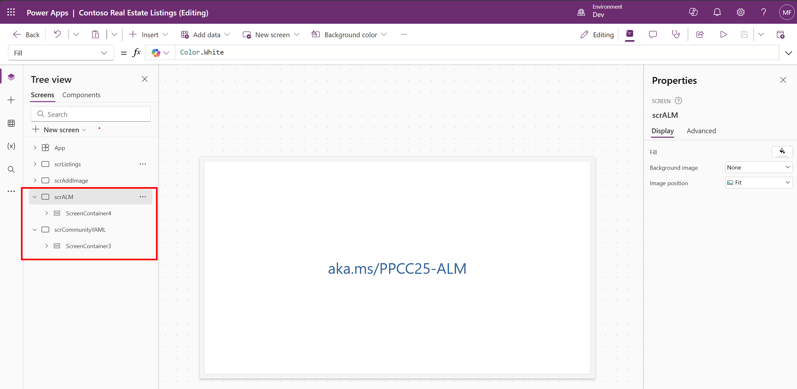

### Step 2: Save, publish and commit changes

Now that you've made changes to your canvas app, you'll save those changes locally, publish them to make them live, and then commit them to your Git repository to preserve the changes in source control.

1. **Save the app**
   - Click **Save** in the app designer
   - Add a meaningful save comment

1. **Publish the app**
   - Click **Publish** to make changes available
   - Confirm the publication
   - **Important:** Only published apps are available to be committed. You must publish before you can commit changes to the repository.
   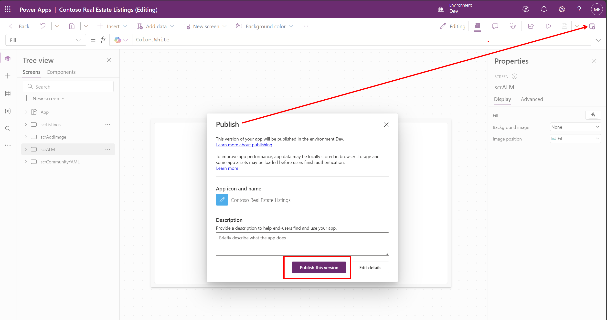
   - Click Back, to go back to solution explorer

1. **Commit to repository**
   - Go to **Source control** tab in your solution
   - Add commit message: "Updated canvas app with new YAML snippet"
   - Click **Commit**
   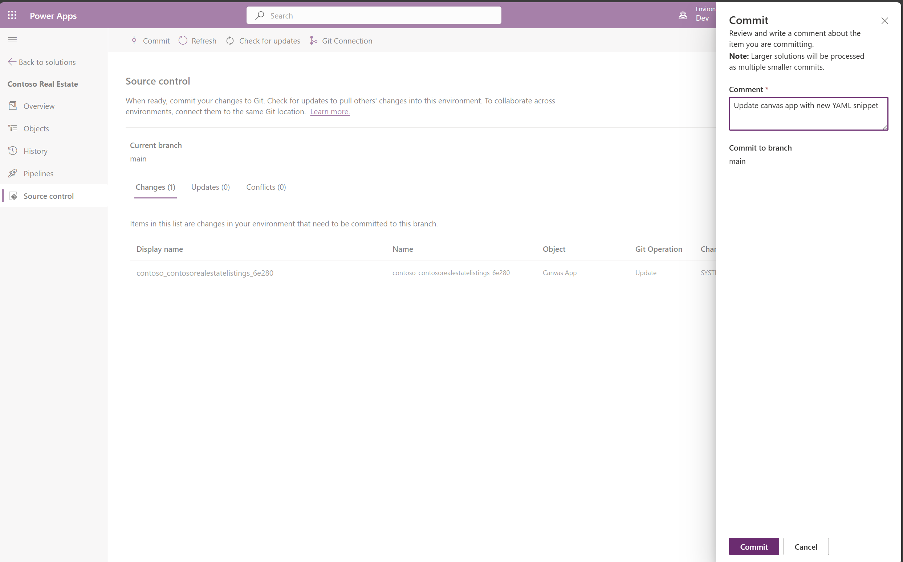

1. **Review the changes in Azure DevOps**
   - Click in the link in the message "Commit Successful.
   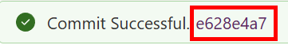
   - Review the committed files and changes.
   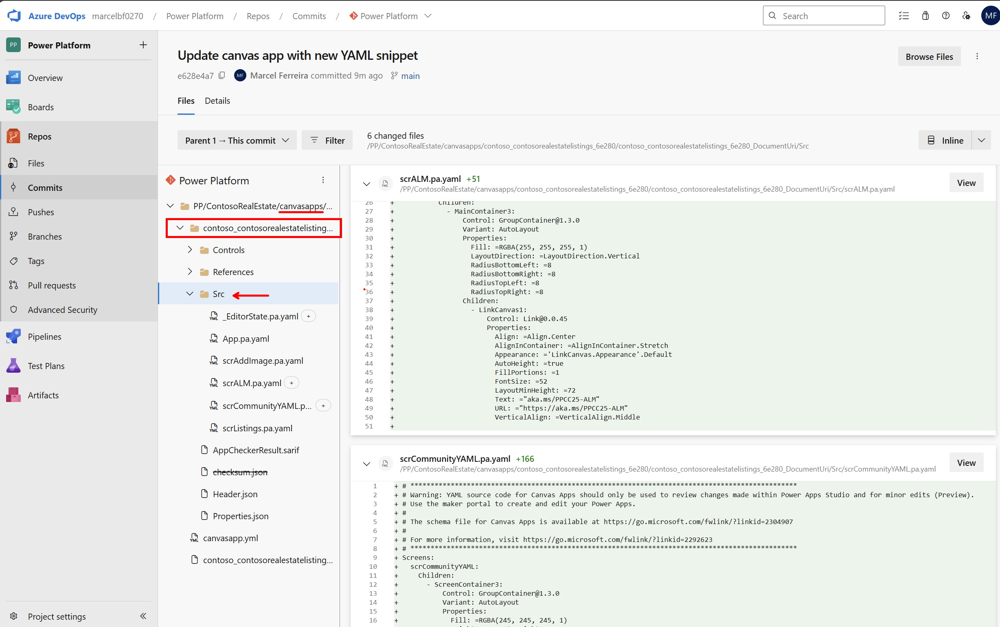

> **Key takeaway:** You have successfully used the maker portal to commit and update your source code in Azure DevOps. Your changes are now version controlled and available for collaboration.

### Step 3: Make changes from the repository using vscode.dev

Professional developers often use specialized tools to compare, review, and make changes directly to the repository. In this step, we'll use VS Code (via vscode.dev) to demonstrate how developers can work with the unpacked solution files directly in source control, making targeted changes to YAML files without going through the maker portal.

1. **Open repository in vscode.dev**
   - Using your browser, navigate to 'vscode.dev'
   - Select **Open Remote Repository**
   - Select **Open Repository from Azure DevOps**
   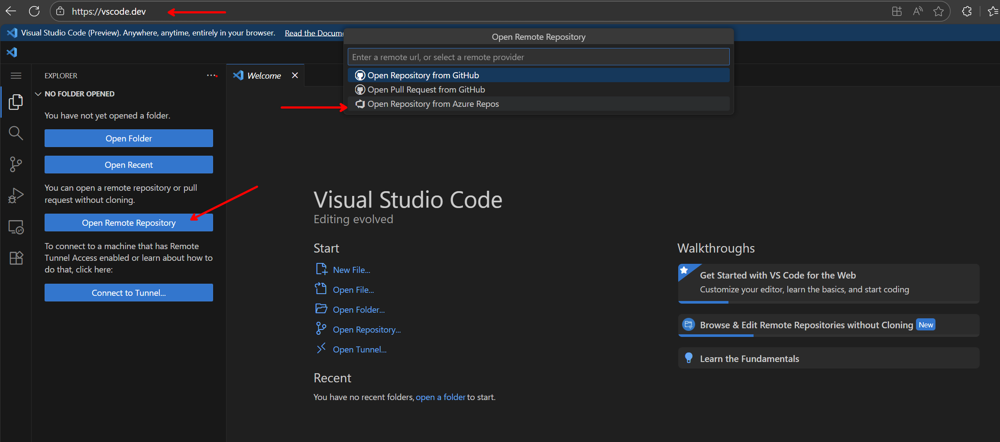
   - Use **your lab user** to sign in
   - Chose your organization and your repository
   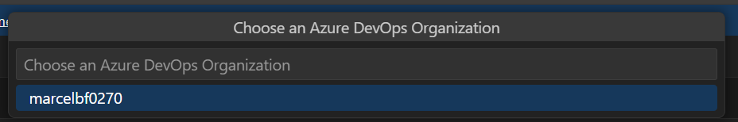
   - Use explorer to navigate on your repository

1. **Find and edit YAML files**
   - Navigate PP -> ContosoRealEstate -> Canvasapps -> your app name
   - locate the Src folder
   - select the file **scrALM.pa.yaml**
   - Locate a YAML file (e.g., screen configuration)
   - Make a minor change (update the property **Text** to **"TEXT UPDATED FROM MY REPOSITORY"**)
   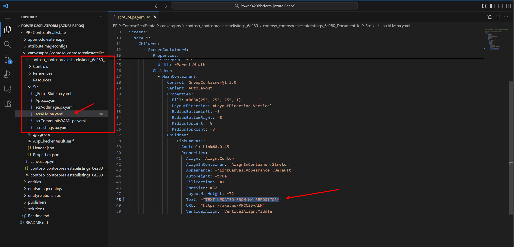

### Step 4: Commit changes using VS Code

1. **Stage and commit changes**
   - Use the Source Control panel in vscode.dev
   - Stage your changes
   - Add commit message: "Minor YAML update from repository"
   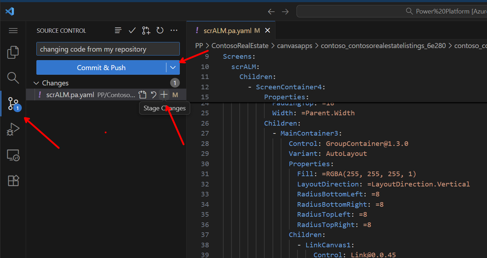
   - Commit and push changes

### Step 5: Reverse sync - Get changes from repository

**Important concepts:**

- **Reverse Sync**: Getting code changes from the repository back into your maker portal environment
- **Source of Truth**: In conflict situations, you must decide whether the repository or maker portal version is correct
- **No merging**: Unlike traditional code, you don't merge Power Platform conflicts - you choose one source as authoritative

1. **Perform reverse sync in maker portal**
   - Return to your solution in Power Apps maker portal
   - Go to **Source control** tab
   - Click **Check for updates** to bring changes in your repository.
   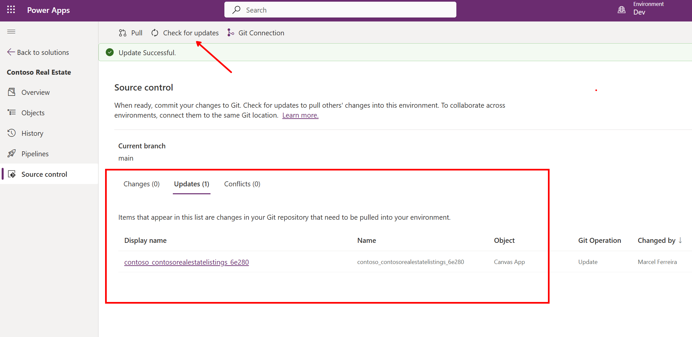
   - Review the incoming changes
   - Click Pull to bring the changes

   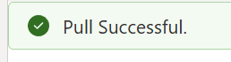

1. **Verify changes applied**
   - Open the canvas app to confirm your repository changes are reflected
   - Check that the YAML modifications are visible
   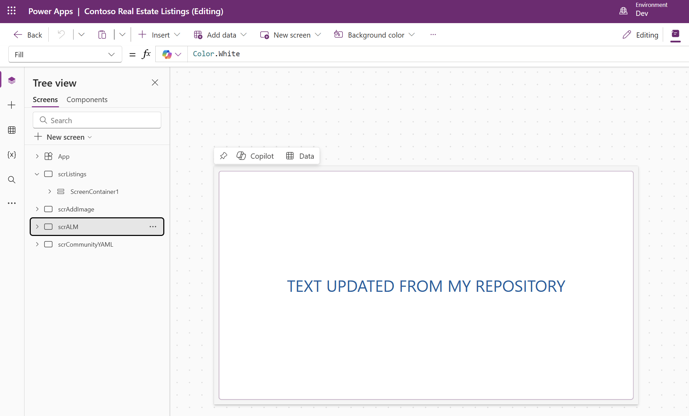

### Step 6: Create a conflict scenario

1. **Make simultaneous changes**
   - **In maker portal**: Edit the same canvas app element you modified in the repo. Save and publish the app.
   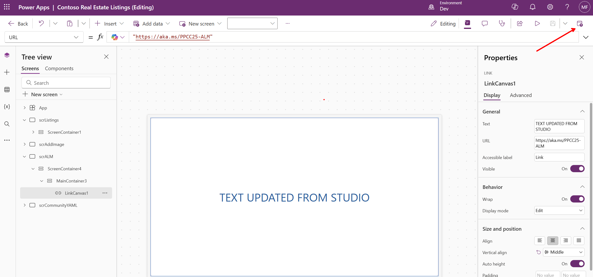
   - DON'T COMMIT (we want to keep the repository out of sync)

   - **In repository**: Using vscode.dev, make a different change to the same YAML property
   - Commit from VSCODE only.
   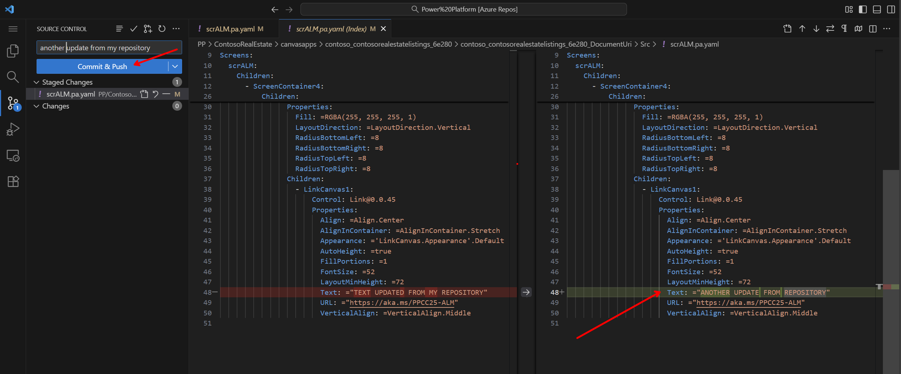

   Now, go back to maker portal, open your solution and **Check for updates** from your repo.

   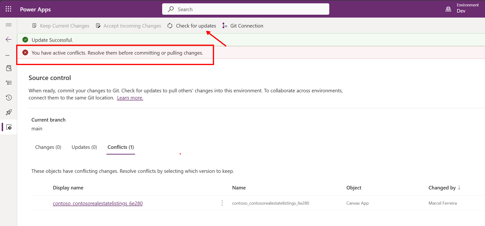

1. **Handle the conflict**
You can choose how you will handle this conflict.
   - If you decide to keep changes from your environment, select **Keep current changes**.
      - You will still need to commit your changes to update the repository. This will override the changes that were made directly in the repository.
   - If you decide to take the changes from your reporitory, select **Accept Incoming Changes**
      - This will discard the changes from your environment. After that, select **Pull** to bring the changes from the repository into your environment.

**Scenario:** You've now simulated a real-world development situation where two developers are working on the same solution simultaneously:

- A **maker** used the Power Apps portal to modify the canvas app
- A **pro developer** used VS Code to make changes directly to the repository

This demonstrates why maintaining a **1:1 relationship between environment and branch** is critical - two developers should not work on the same branch, as changes made in parallel can conflict. Now we'll see how to bring the developer's changes back into the maker portal.

- **Important**: You'll need to choose your source of truth
- **Repository wins**: Accept repository version (recommended for team scenarios)
- **Maker portal wins**: Keep maker portal version and commit over repository

1. **Resolution strategy**
   - Decide on your source of truth based on context
   - Communicate with team about the chosen resolution
   - Document the decision for future reference

> **Expected outcome:** You understand how to work with both maker portal and repository, handle reverse sync, and resolve conflicts by choosing a source of truth.
> **Key learning**: More complex merge scenarios and team collaboration patterns will be covered in the next lab.

---

## 👥 Task 3: Work as a team in multiple environments

In this task, we will simulate team development using multiple Power Platform environments. This demonstrates how different developers can work on the same solution using separate development environments while maintaining code synchronization through Git.

**Prerequisites:** You'll need access to a second development environment for this exercise. We will call this environment **Hotfix**

### Step 1: Set up the Hotfix environment

1. **Export your Contoso Real Estate solution from Dev environment**
   - In the Power Apps maker portal, make sure you're in your **Dev** environment
   - Click **Solutions** in the left navigation
   - Select the **Contoso Real Estate** solution
   - Click **Export** in the top menu
   - In the dialog "Before you export", click **Publish**.
   - Click next.
   - In the export dialog, select **Unmanaged** solution type
   - Click **Export**
   - Wait for the solution to be prepared (this may take a few moments)
   - The solution will download as a `.zip` file to your computer
   - Save this file in an easily accessible location

1. **Switch to your Hotfix environment**
   - In the Power Apps maker portal, use the environment selector
   - Choose your Hotfix environment
   - If you don't have one, create a new developer environment

1. **Import the solution into Hotfix environment**
   - Click **Solutions** > **Import solution**
   - Click **Browse** and select the solution `.zip` file you just exported from your Dev environment
   - Click **Next**
   - Review the solution information
   - Click **Import** and wait for completion
   > **Note:** You're importing the exported solution from your Dev environment which includes all your recent changes. This allows you to have a consistent starting point in the HotFix environment for testing multi-environment workflows.

### Step 2: Connect Hotfix Environment to Git repository with a new branch

Now we'll create a new Git branch from the main branch to work in an isolated environment. This simulates a hotfix scenario where you need to make urgent production fixes without impacting ongoing development work.

1. **In your hotfix environment**
   - Open the Solution **Contoso Real Estate**
   - Select **Source control**
   - Click connect
   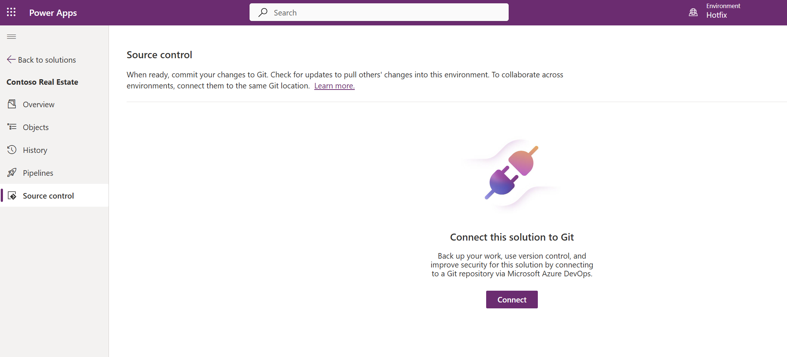
   - select the options bellow:
   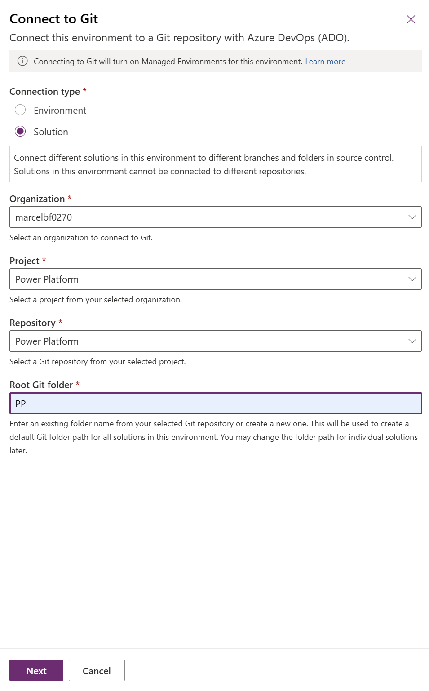
   - In the next screen, select **Create new branch**
   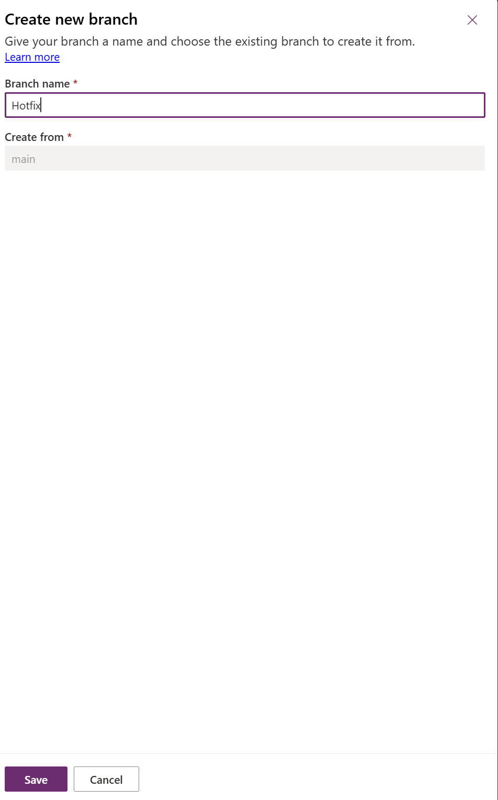
   - Click connect to complete
   - Wait until all the changes in the environment are processed.
   - Select **Check for updates**, to compare your environment with the content from your repo.
   - If you have conflicts, select all conflicts, and click **Accept Incoming Changes**
   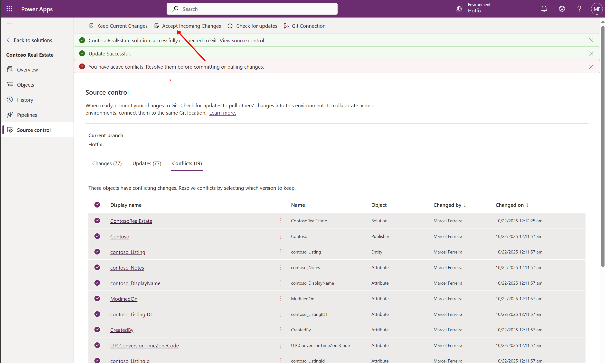
   - Confirm you want to accept the changes from your repository.
   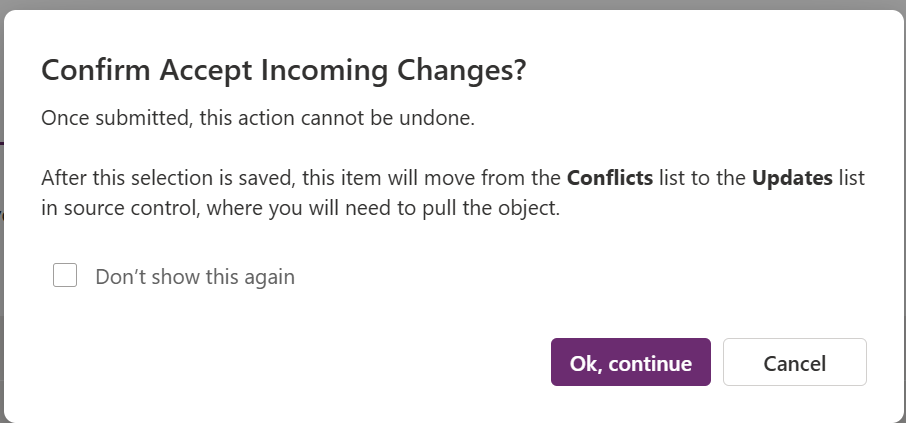
   - Click **Pull** to apply the changes from your repository to your environment.

**Important concept:** In Power Platform, we recommend maintaining a **1:1 relationship between environment and branch**. Each development environment should be connected to its own dedicated Git branch for clean separation of work.

### Step 4: Make changes in Hotfix Environment

In this step, you'll simulate a hotfix scenario by making a critical update to the canvas app in your HotFix environment. Since the HotFix branch is isolated from your main development branch, you can work independently and commit changes without affecting ongoing development work.

1. **Open the solution in the HotFix environment**
   - In the HotFix environment, navigate to your imported solution
   - Find and open the Canvas app component
   - This is the base version without your previous development changes

1. **Make a hotfix change to the canvas app**
   - Open the Canvas app in edit mode
   - Make a targeted change that simulates a production hotfix (e.g., fix a button label, update a formula, or correct text)
   - Keep the change focused and minimal, as hotfixes typically target specific issues
   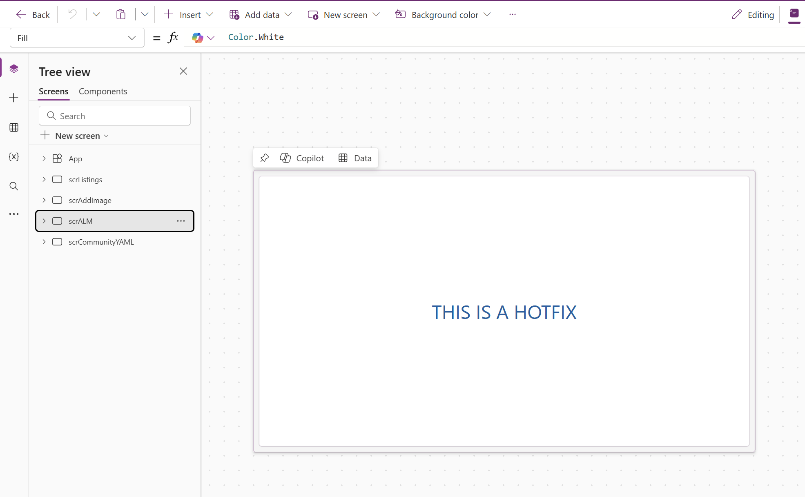

1. **Save the app**
   - Click **Save** in the app designer
   - Add a meaningful save comment that describes the hotfix (e.g., "Hotfix: Corrected button text")

1. **Publish the app**
   - Click **Publish** to make the changes available
   - Confirm the publication
   - **Important:** Only published apps are available to be committed. You must publish before you can commit changes to the repository.

1. **Commit the hotfix to your HotFix branch**
   - Go to **Source control** tab in your solution
   - Add a commit message: "Hotfix: [description of the fix]"
   - Click **Commit** to save the changes to your HotFix branch in the repository
   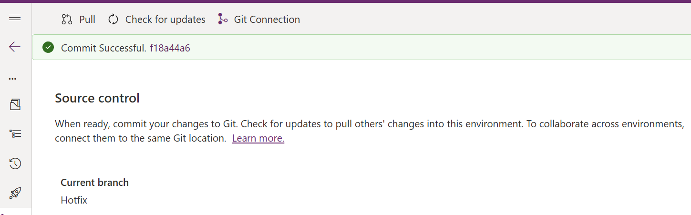

1. **Verify the hotfix commit in Azure DevOps**
   - Navigate to your Azure DevOps repository
   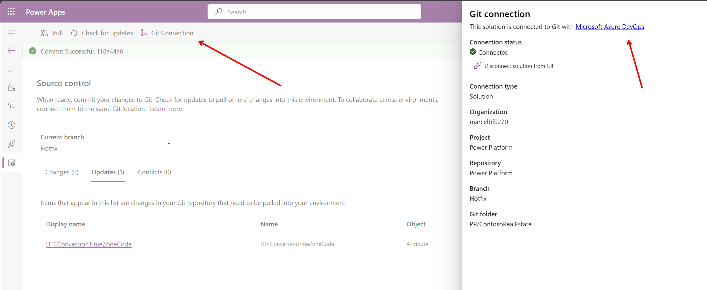
   - You should be in the **Hotfix** branch. Select **Create pull request** to send changes to main
   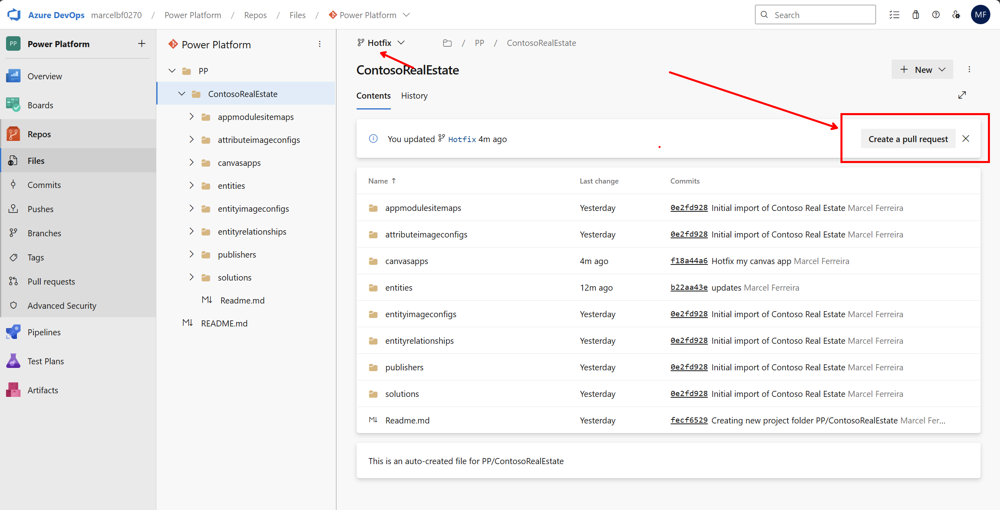
   - Add title and description, and click create.
   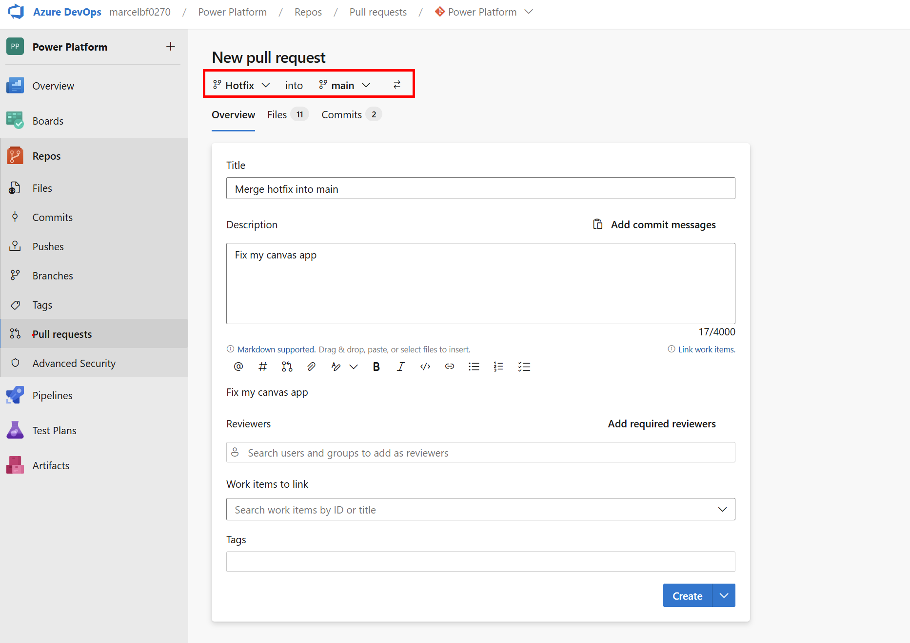
   - You should have no merge conflicts. Complete the PR.
   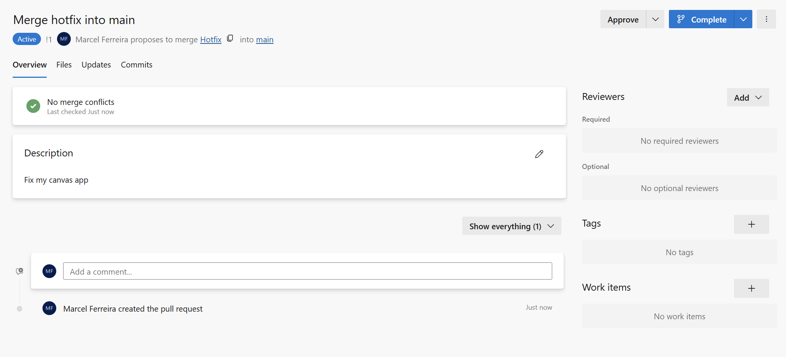

1. **Update your dev environment with hotfix from repository**
   - In the Dev environment, navigate to the Contoso Real Estate solution.
   - Navigate to Source Control.
   - Click **Check for updates**
   - Pull the changes
   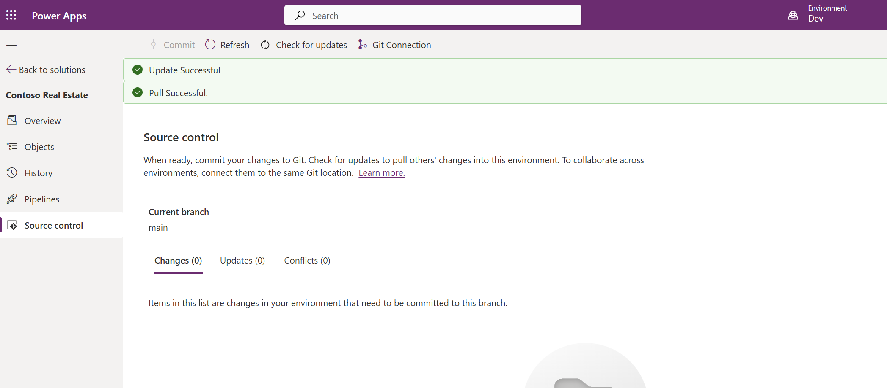
   - You should have the hotfix now. Open your canvas app to confirm
   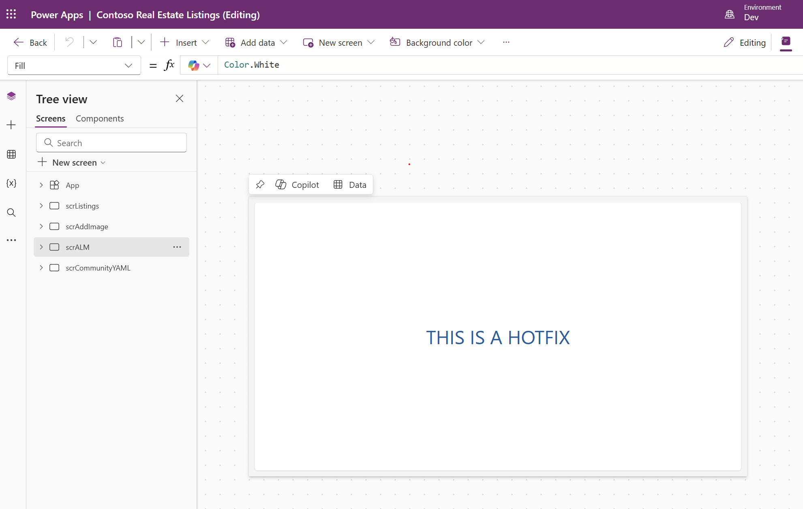

> **Expected outcome:** You've successfully created an isolated hotfix in a separate branch, demonstrating how to handle urgent production fixes without impacting ongoing development work.
> **Key learning:** The 1:1 environment-to-branch relationship keeps development organized and makes it easier to track which changes come from which developer or environment.

---

## 🤖 Task 4: Build Zava Quality Operations with an agent and code app

In this task, you will create two components for Zava's quality team:

- **Zava Quality Guide**: an agent powered by the GitHub Copilot harness that explains a synthetic inspection and escalation policy.
- **Zava Quality Incident Tracker**: a Power Apps code app created from a natural-language prompt.

Both components belong to the **Zava Quality Operations** solution, but they have different authoring models. The agent is authored in Copilot Studio. The code app is authored as a normal React and TypeScript project, built locally, and then published to the solution.

### What you will learn

- Create an agent with instructions and a knowledge source.
- Inspect the agent in a Power Platform solution.
- Create and run a code app through a maker-friendly AI-assisted workflow.
- Publish the built app into a specific solution.
- Decide which source belongs in Git and which artifacts belong in the solution.

### Before you start

Your workshop environment must have:

- Copilot Studio with the GitHub Copilot harness available.
- Power Apps code apps enabled.
- A GitHub account with GitHub Copilot access.
- GitHub Copilot CLI, Node.js LTS, and Git installed.
- Environment Maker access in the **Dev** environment.

> **Account check:** GitHub Copilot uses your GitHub identity. Power Apps and Copilot Studio use your workshop Microsoft identity. Confirm both accounts before starting.

---

### Step 1: Create the Zava Quality Operations solution

1. Go to [Power Apps](https://make.powerapps.com).
1. Switch to your **Dev** environment.
1. Select **Solutions**.
1. Create a solution with these values:
   - **Display name**: `Zava Quality Operations`
   - **Name**: `ZavaQualityOperations`
   - **Publisher**: Select the workshop publisher provided by your instructor.
   - **Version**: `1.0.0.0`
1. Set **Zava Quality Operations** as your preferred solution.
1. Open the solution and copy its solution ID from the browser URL. You will use this ID when publishing the code app.

The URL has this shape:

```text
https://make.powerapps.com/environments/<environment-id>/solutions/<solution-id>/overview
```

> **Expected result:** Zava Quality Operations is the preferred solution, and you have saved its solution ID.

---

### Step 2: Create the Zava Quality Guide

1. Open [Microsoft Copilot Studio](https://copilotstudio.microsoft.com).
1. Confirm that you are in the same **Dev** environment.
1. Create an agent powered by the **GitHub Copilot harness**.
1. Use the [Zava Quality Guide prompt](assets/zava-quality/zava-quality-agent-prompt.md) to define the agent.
1. In **Build**, review the generated name, description, and instructions.
1. Add [ZavaCore Quality Inspection Guide](assets/zava-quality/zava-quality-inspection-guide.md) as a knowledge source.
1. Save the agent.

The lab uses a small file-based knowledge source so that you can focus on the agent's ALM representation instead of configuring Dataverse or a connector.

#### Test the agent

In **Preview**, ask:

> A ZavaCore Field batch is missing its traceability record. What should I do?

The agent should classify the issue as a quality hold, tell you to isolate the batch, and direct you to notify the quality lead within four business hours.

Then ask:

> What customer discount should I offer for this issue?

The inspection guide does not define customer discounts. The agent should say that the answer is not in its approved source and direct you to the appropriate owner instead of inventing a policy.

> **Expected result:** The agent answers from the supplied inspection guide and respects its stated boundaries.

---

### Step 3: Inspect the agent in the solution

1. Return to [Power Apps](https://make.powerapps.com).
1. Open **Zava Quality Operations**.
1. Locate **Zava Quality Guide** in the solution objects.
1. Review the related components and dependencies shown for the agent.

The solution contains the agent configuration required for ALM. The Copilot Studio authoring experience can include instructions, knowledge, tools, skills, and other capabilities. Do not assume that every authoring concept always maps to one separately editable file in an unpacked solution.

> **Key point:** Copilot Studio is the agent's authoring surface. The solution is its deployment boundary.

---

### Step 4: Vibe-code the Zava Quality Incident Tracker

The workshop uses GitHub Copilot CLI with the official Power Apps code apps plugin. Your instructor should preinstall the plugin. If it is not installed, start Copilot CLI and run:

```text
/plugin marketplace add microsoft/power-platform-skills
/plugin install code-apps-preview@power-platform-skills
```

Close and reopen the terminal after installation.

1. Create an empty working folder outside the workshop content repository.
1. Open a terminal in that folder.
1. Start GitHub Copilot CLI:

   ```powershell
   copilot
   ```

1. Invoke the code-app creation skill:

   ```text
   /code-apps-preview:create-app
   ```

1. Paste the [Zava Quality Incident Tracker prompt](assets/zava-quality/zava-quality-code-app-prompt.md).
1. Replace `<environment-id>` with the ID of your **Dev** environment.
1. Review the proposed plan before approving it.
1. If the agent proposes a connector, database, authentication system, or backend, ask it to keep local sample data instead.
1. Approve the plan and let the agent create the app.
1. When asked whether to deploy, choose **No**. You will publish explicitly to the Zava Quality Operations solution in the next step.
1. Open the local play URL and verify that you can:
   - View synthetic quality incidents.
   - Filter by product, severity, and status.
   - Open the new-incident form.
   - Add a local incident.

> **Expected result:** The app runs locally and uses synthetic local data only.

#### Look at the editable source

Open the generated project in Visual Studio Code. Locate:

```text
src/
package.json
package-lock.json
tsconfig.json
vite.config.*
power.config.json
```

These files are the editable code-app project. This project belongs in the team's normal Git repository.

---

### Step 5: Publish the code app into the solution

In the generated project folder, build the application:

```powershell
npm run build
```

Publish the compiled app to the solution ID you copied earlier:

```powershell
pa app push --solution-id <solution-id>
```

When the command completes:

1. Return to **Zava Quality Operations** in Power Apps.
1. Refresh the solution.
1. Confirm that **Zava Quality Incident Tracker** appears under **Apps**.
1. Run the published app once to confirm that it loads in the Power Apps host.

If an app was previously published without a solution, you can also add it through **Add existing** > **App** > **Code app**.

> **Expected result:** The code app is deployed as part of Zava Quality Operations.

---

### Step 6: Compare source with the solution

The same application now exists in two forms:

| Location | What it contains | How to use it |
|---|---|---|
| Code-app Git repository | React or TypeScript source, tests, package manifests, lockfile, and build configuration | Edit, review, branch, merge, test, and rebuild |
| Power Platform solution | App registration metadata and built runtime artifacts such as bundled JavaScript, CSS, and static assets | Export, import, deploy, and govern |

The solution does not contain the authoritative original React or TypeScript project. Unpacking the solution cannot reliably restore the original modules, comments, tests, or project structure.

Power Apps code apps also do not currently support Power Platform Git Integration as a source-code integration mechanism. Keep the editable project in a normal Git repository and build it before publishing its runtime output to the solution.

> **Do not edit generated bundle files.** Change the source project, rebuild it, and publish the new output.

---

### Step 7: Define the ALM strategy

Use this strategy for Zava Quality Operations:

| Component or artifact | Source of truth | Promotion path |
|---|---|---|
| Zava Quality Guide | Copilot Studio authoring configuration | Power Platform solution |
| Zava Quality Incident Tracker source | External Git repository | Build and publish into the development solution |
| Code-app runtime payload | Generated from the tagged source revision | Power Platform solution |
| Zava Quality Operations release | Exported solution artifact | Power Platform Pipelines through Dev, Test, and Production |

The complete flow is:

```text
Copilot Studio authoring ───────────────────────────────┐
                                                       v
Code-app Git source -> build -> compiled runtime -> Zava Quality Operations solution
                                                       |
                                                       v
                                            Test -> Production
```

> **Expected outcome:** You created an agent and code app in one solution and can explain why their editable sources follow different ALM paths.
>
> **Key insights:**
>
> - A solution is the shared deployment boundary, not a universal authoring format.
> - Agent configuration is authored in Copilot Studio and transported through the solution.
> - Code-app source remains in Git; the solution contains its built runtime representation.
> - Build from a known Git revision, publish to the development solution, and promote the resulting solution through controlled environments.
