# 🚀 Lab 3: Deploy

> **💡 Prefer a guided, step-by-step experience?** Open the [interactive Lab 3 guide](https://microsoft.github.io/PPCC26-ALM/labs/lab3/guide.html). It walks you through the same lab one step at a time, fills in your environment values, and tracks your progress. You can also download [guide.html](guide.html) and open it in your browser.

A key facet of healthy ALM is separating changes in development from those in testing and in production. Pipelines in Power Platform deploys the latest version of your solution across these environments, with the ability to add secure approvals and review changes before they're deployed. Note: in this lab you'll only deploy from development to production, but in the real world it's recommended to add an additional test stage. Other stages may also be added.

---

## 📋 Prerequisites

1. Complete Lab 2 (the Zava Quality Operations solution with the Zava Quality Guide agent and the Zava Quality Incident Tracker code app).
1. If you did not complete Lab 2, import the [ZavaQualityOperations.zip](assets/ZavaQualityOperations.zip) unmanaged solution in your development environment. This solution is available in your lab materials folder.
1. Make sure Power Apps code apps are enabled in your development and target environments before you import or deploy the solution: in the Power Platform admin center, open each environment > **Settings** > **Product** > **Features**, turn on **Power Apps code apps**, and click **Save**. If this setting is off, the code app is skipped during import and deployment without an error.

---

## ✅ Lab 3 Tasks

- Types of Pipelines
- Task 1 - Create a Platform Host pipeline
  - Deploy using Platform Host pipeline
- Task 2 - Create a Custom Host pipeline
  - Create a Custom Host environment
  - Configure environment records for the pipeline
  - Configure a basic pipeline
  - Deploy using a Custom Host pipeline
- Task 3 - Extend pipelines (optional, but highly recommended)
  - Gated extensions
  - Create an Application User
  - Create Sharing Security Group
  - Create application user in Dataverse
  - Create an approval + SPN delegated deployment flow
  - Update flow after solution import
  - Update pipeline to run as delegated
  - Run SPN delegated pipeline
- Task 4 - Redeploy a prior version
- Appendix - Steps to enable Managed Environments

---

## 📚 Types of Pipelines

There are **two** ways to configure Power Pipelines—

**Platform host** - Out of the box tenant-wide pipelines ghosted under a "platform host" configuration. These pipelines are configured by makers for personal use. Personal pipelines cannot be extended, nor can they be shared with other makers in the tenant.

**Custom host** - Pipelines configuration hosted under a custom environment, where Power Pipelines modules are installed by admins. Custom pipelines are centrally governed by admins and shared with makers for use.

---

## 🎯 Task 1 - Create a Platform Host Personal Pipeline

1. Navigate to your development environment. This is where you have built your solution that you would like to deploy to QA and Production
1. Click on **Solutions** tab in the left-hand navigation blade
1. Once in the Solutions page, open your unmanaged solution which you want to deploy
1. On the left-hand navigation panel, click on the **rocket icon** for Power Pipelines page
1. On the Pipelines page, select **+ Create new pipeline**
1. In the Create pipeline pop out wizard, provide the following details:
   - **Name:** `<Your Name> Platform Host Pipeline`
   - **Description:** Include description of which environments this pipeline will deploy to
   - **Target environment:** select your Development 2 environment (where you enabled ME earlier in this lab)
   - Click **Save**

   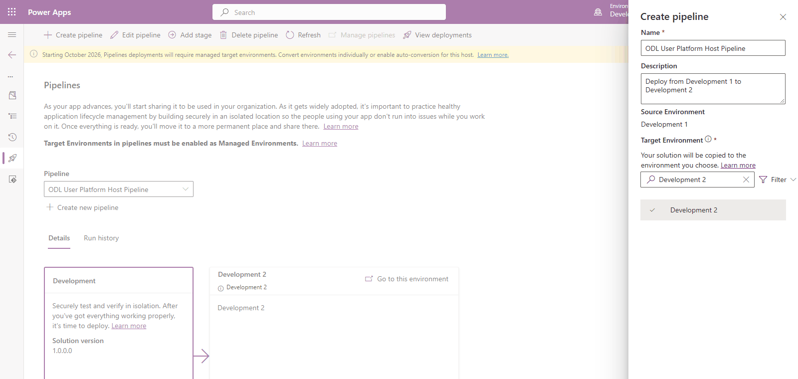

### Deploy using a Platform Host pipeline

1. You're now ready to use this Pipeline to deploy your solutions! If your specific deployment process requires an additional environment, click on Add Stage button to add additional stages.

   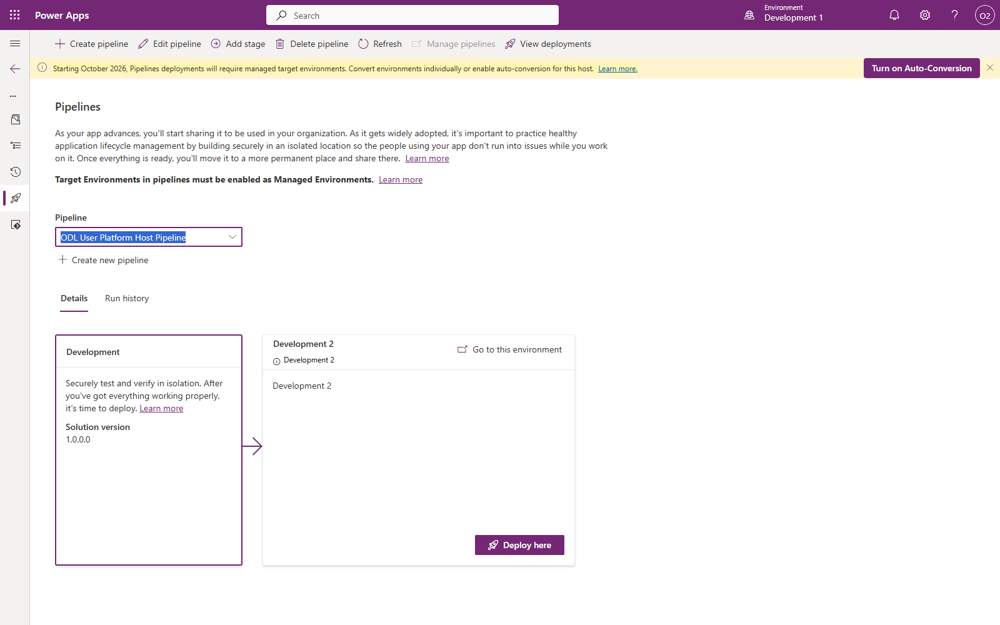

1. On the Development 2 environment stage, click **Deploy here** to initiate the solution deployment to Development 2.
1. You can schedule deployments by selecting Later in the Deployment Schedule section, and selecting a time and date when you'd like to automatically deploy.
1. Click **Next**
1. In the summary section, notice the **Deployment Notes** section was populated using AI-generated summary of your solution's capabilities.
1. Click **Deploy** to begin your deployment

   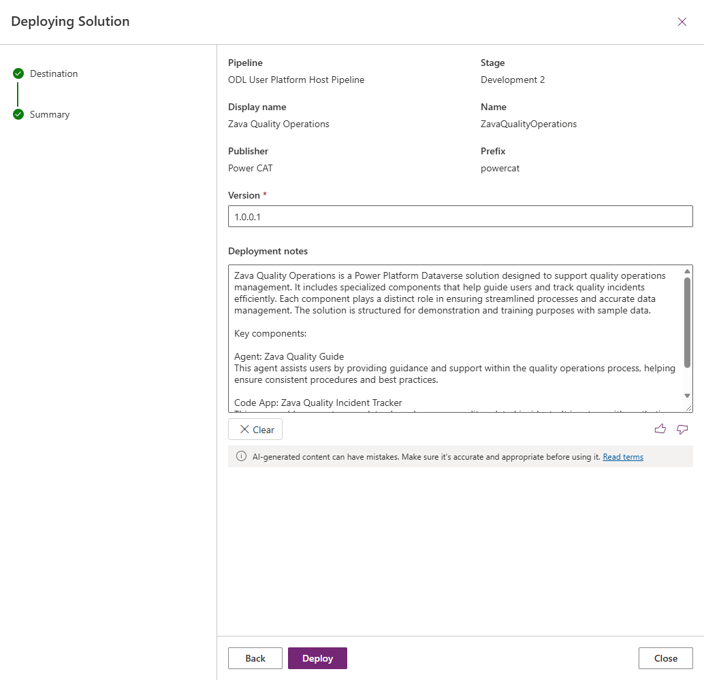

Your Development 2 stage will update with the progress of the deployment:

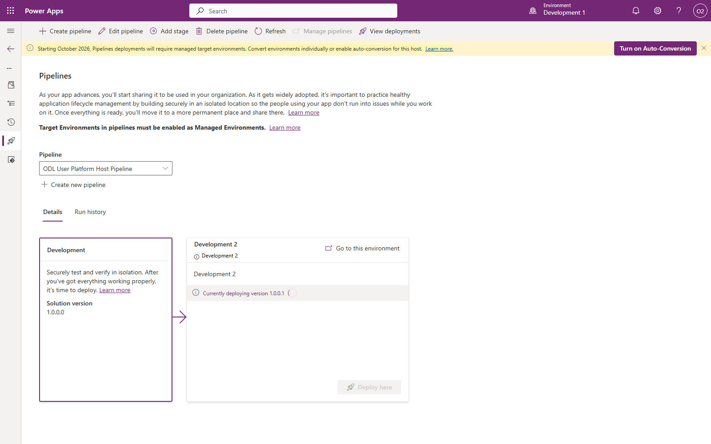

When the deployment completes, you can see the success message on the stage:

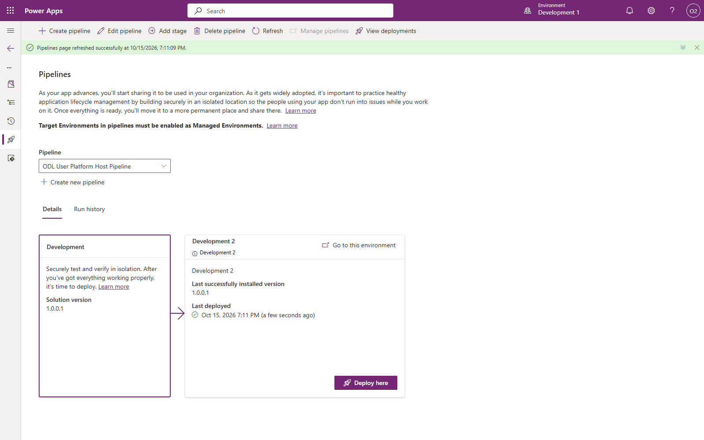

> **Remember:** Platform Host pipelines are not shareable, nor can they be extended to support approvals or delegations. Continue to the Custom Host Pipelines section to create extendable and shareable pipelines.

---

## 🏗️ Task 2 - Create a Custom Host Pipeline

### Create a Custom Host environment

Let's begin by installing the Power Pipelines modules on a designated Pipeline orchestrator environment. While this module does not have to be installed in a dedicated environment, it is encouraged to do so.

1. In the Power Platform Admin Center (https://admin.preview.powerplatform.microsoft.com/) select **Deployments** from the left-hand navigation panel
1. Make sure you are on the **Overview** tab
1. Click **+ New custom host** button to kick off a new environment creation with Power Platform Pipelines modules pre-installed.

   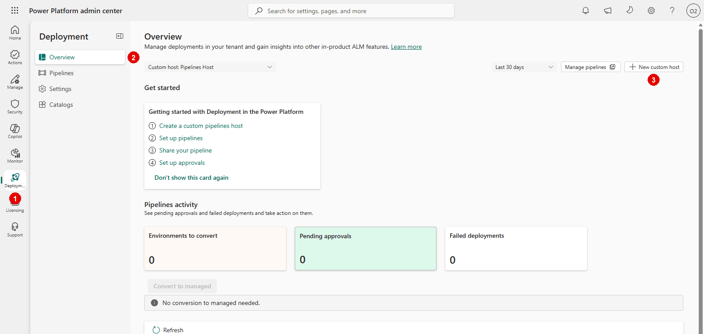

1. Configure the New Environment creation:
   - **Name:** "Custom Host Environment"
   - **Make this a Managed Environment:** Yes
   - **Type:** Trial
   - **Macro Region Geography:** select your region

   > **Note:** Create the custom host as a **Trial** environment, not a Developer environment. Each user can have up to 3 Developer environments, so creating the custom host as a Trial lets you keep 3 Developer environments plus 1 Trial environment (the custom host). If you pick Developer and you already have 3 Developer environments, Save keeps loading and the environment is not created. In this lab's screenshots, the custom host environment is named Pipelines Host.

   - Click **Next**
   - Under Security Group, click **+ Select**, select **None**
   - Click **Save**

<p>
  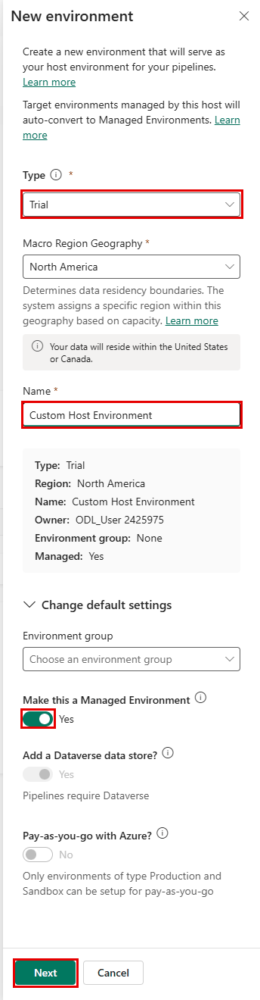
  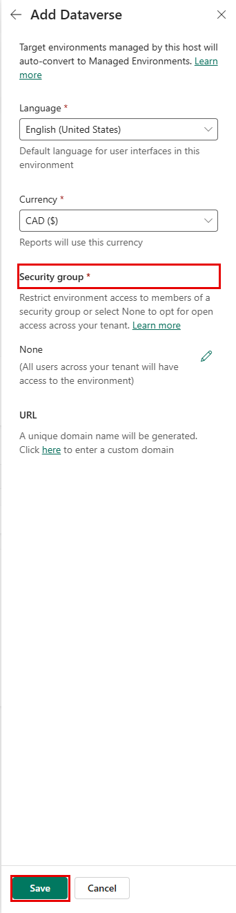
</p>

Now that the Custom Host Environment is created, we can begin configuring the custom host pipeline. Since the tenants provided for today's lab contain pre-created environments, before we begin, let's first select which environments we will be using for this lab. Please fill out this worksheet for each environment:

| Environment Name | Environment Type | Environment ID |
|---|---|---|
| | **Dev** | |
| | **Target** | |

### Configure environment records for the pipeline

1. Navigate back to PowerApps maker portal at https://make.preview.powerapps.com/
1. In the top right hand corner in the Environment selection dropdown, select the **Custom Host Environment** which you just created
1. Click on the **Apps** tab
1. Click on the **Deployment Pipeline Configuration** app to play it

   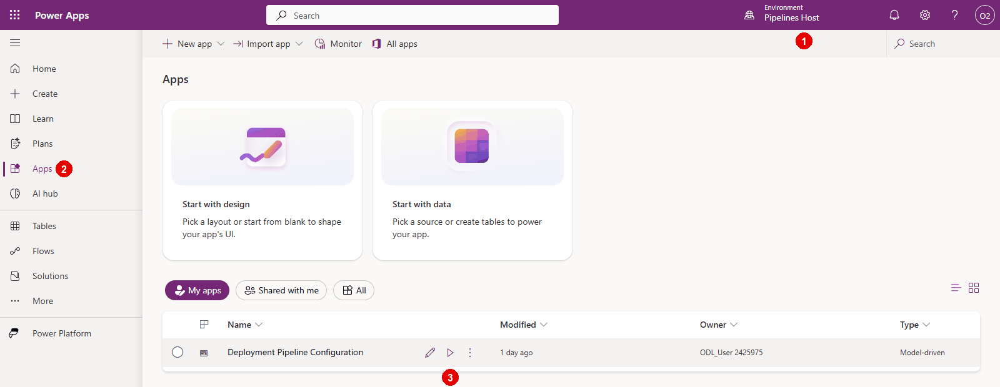

1. In the Deployment Pipeline Configuration app, select **Environments** on the left pane

   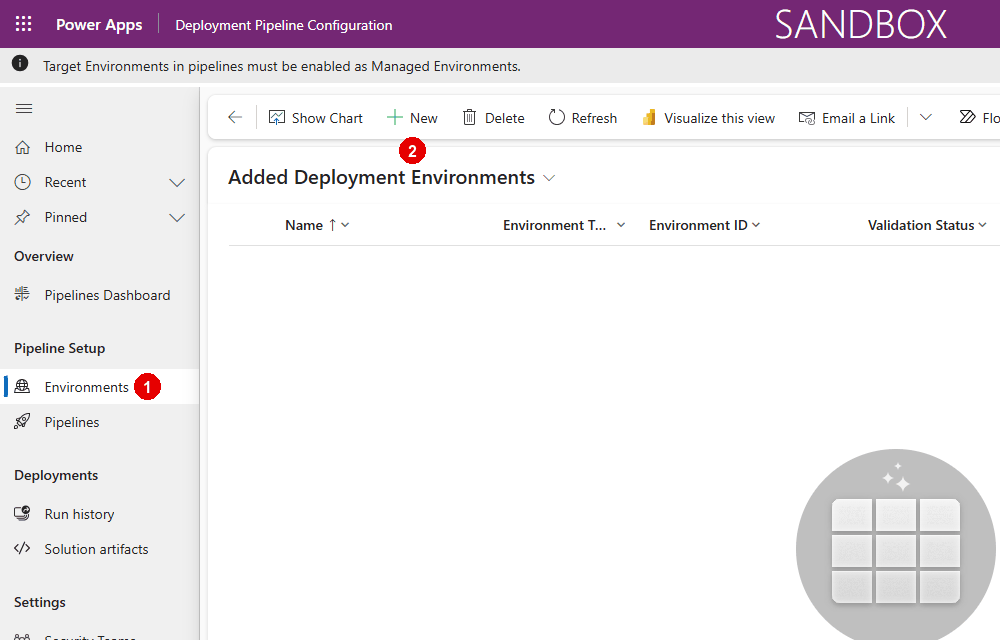

1. Let's create the development (source) environment record. Select **New** in the ribbon to create a new environment record
   - **Name:** `<Environment name of the developer env you selected at the beginning of the lab>`
   - **Environment Type:** Select Development for your source environment
   - **Environment Id:** `<Environment ID of the developer env you selected at the beginning of the lab>`
   - Click **Save**
   - Wait for one minute, and click refresh in the ribbon to verify Validation Status equals **Success**

     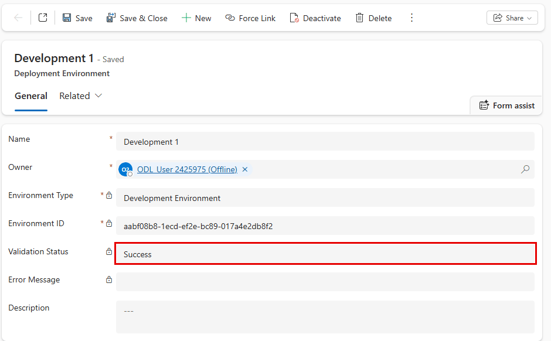

   - **If Validation Status equals Failed**, the environment is already linked to another pipelines host (for example, the platform host your personal pipeline used earlier in this lab). Select **Force Link** in the ribbon, click **Confirm**, wait for one minute, and click **Refresh** until Validation Status equals **Success**.

     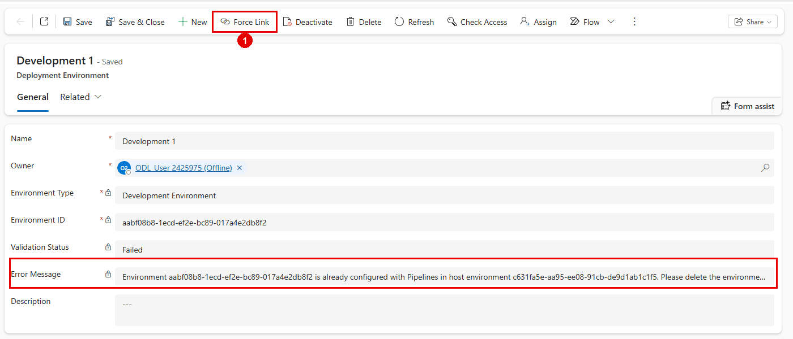

     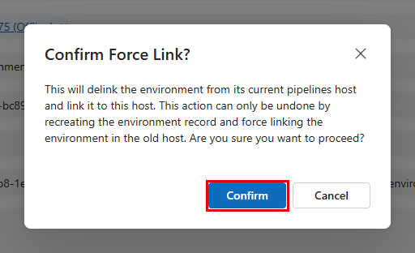

1. Let's create the target environment record. Select **New** in the ribbon to create a new environment record
   - **Name:** `<Environment name of the target env you selected at the beginning of the lab>`
   - **Environment Type:** Select Target for your target environment
   - **Environment Id:** `<Environment ID of the target env you selected at the beginning of the lab>`
   - Click **Save**
   - Wait for one minute, and click refresh in the ribbon to verify Validation Status equals **Success**
   - If validation fails, use **Force Link** as described above.

     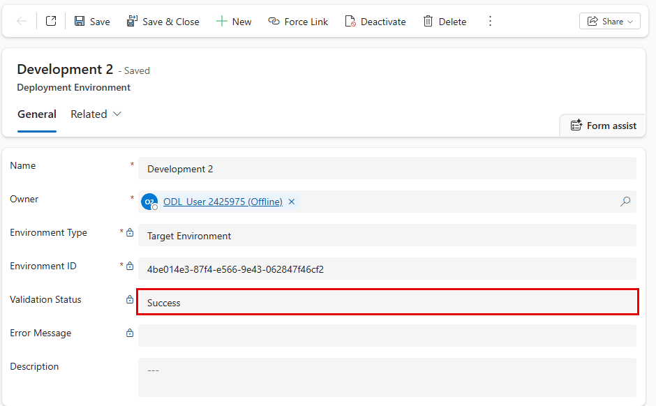

1. Repeat the previous step if you have more than 1 target environment

### Configure a basic pipeline

1. Select **Pipelines** in the left navigation pane

   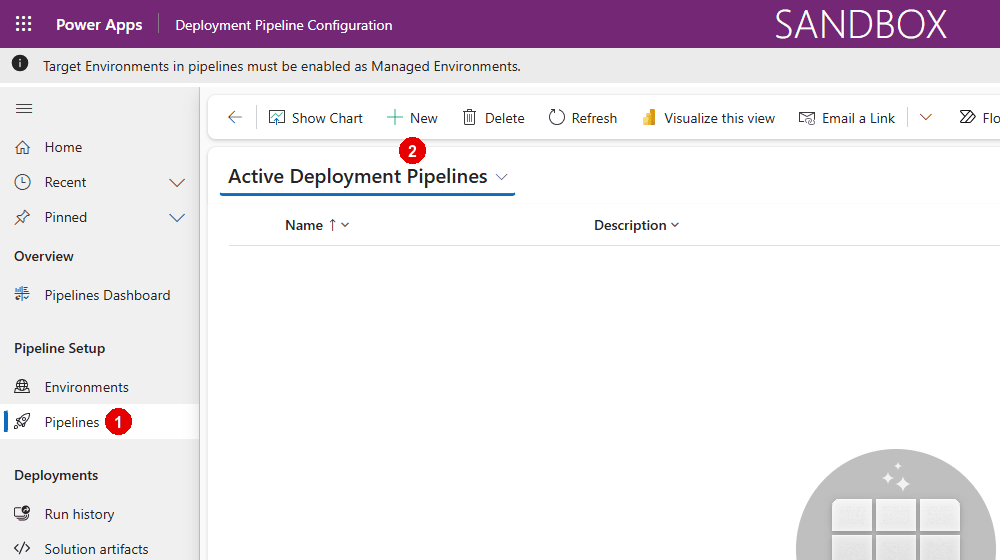

1. Select **New** in the ribbon to create a new deployment pipeline record
   - **Name:** Custom Host Pipeline
   - **Description:** optional, add a description of the purpose this pipeline serves
   - **AI deployment notes:** Enabled
   - **Allow redeployments of older versions:** Enabled
   - **Deployment Type:** Standard
   - Click **Save**

   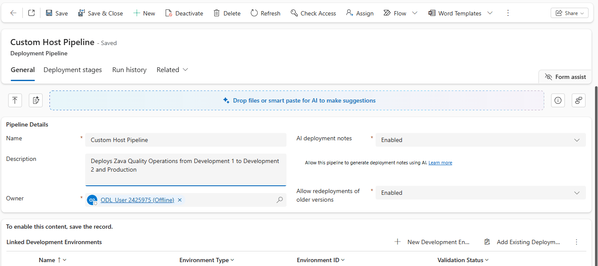

1. Scroll down to the Linked Development Environments grid
   - Click on the three vertical dots on the top right corner of the grid to open additional grid options
   - Select **Add Existing Deployment Environment**, then select the development (source) environment you configured earlier in this lab, then click **Add**

   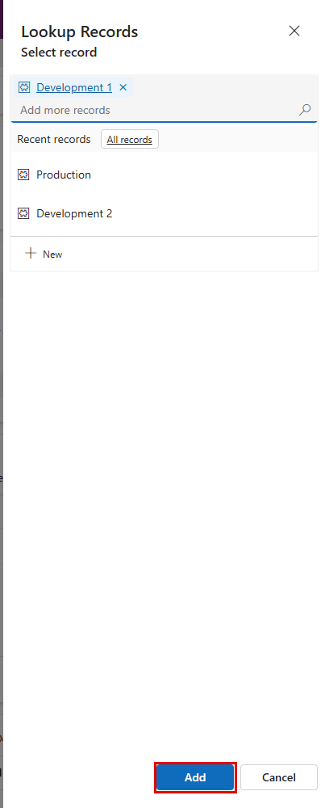

1. In the **Deployment Stages (Deployment pipeline)** grid, select **New Deployment Stage**
1. Complete the form:
   - **Name:** Target Env 1
   - **Description:** optional, add a description of the environment you are deploying to
   - **Previous Deployment Stage:** Leave blank as this will be our first deployment stage
   - **Target Deployment Environment ID:** Select one of the Target environments you configured earlier in this lab.
   - Click **Save and Close**

   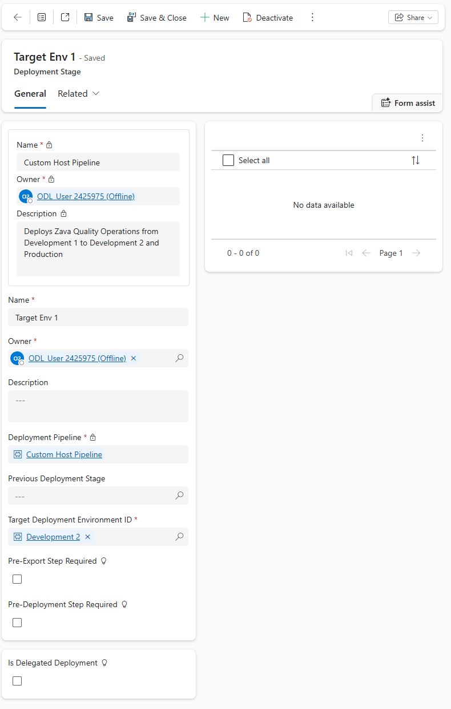

1. In the real world, repeat the previous two steps if you have more than one target environment for your pipeline, with one difference: in the **Previous Deployment Stage** field, select the name of the stage you configured in the previous step (for example, Target Env 1).
1. This pattern can be repeated to add up to 7 deployment stages in your pipeline.

Congratulations! You have created a basic Custom Host Pipeline. Go to your **development** (source) environment, and open any unmanaged solution. Then, click on the **Pipelines tab** (rocket icon) to open the Pipelines pane. Here, you will see your newly created pipeline:

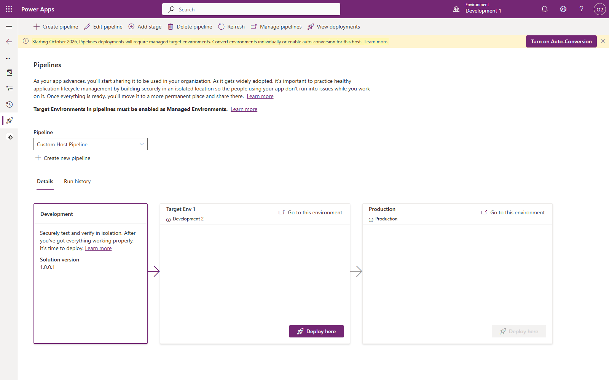

### Deploy Using a Custom Host pipeline

1. Click **Deploy here** button in the Target Env 1 stage
1. You will get a popup which asks you to convert the target environment to a Managed Environment. Remember, Pipelines are a ME only feature. Your Target environments must be enabled for ME to perform a deployment. Click **Convert to managed**

   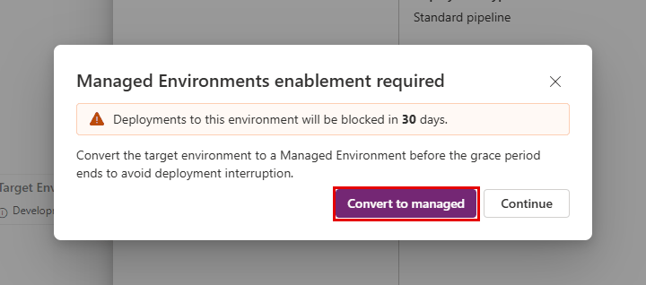

1. Follow the same steps you performed in the Deploy Using a Platform Host pipeline section to complete the deployment.

So far, the two types of pipelines we've explored enable basic deployments only. However, some processes call for greater control over the deployment process to ensure production assets are kept safe from unintentional or unapproved changes. For example, while administrators have permission to deploy to production, it's important makers and developers do not have elevated access. Or, maybe the process mandates an admin or change manager's approval before a deployment to production can be initiated. Let's configure our pipeline to support these processes.

---

## 🔧 Task 3 - Extend Pipelines

### Gated extensions

In this section, we will extend deployment pipelines we created in the sections above. Extending pipelines allows organizations to tailor pipelines to their unique needs. For example, you can add approvals, deploy via service principals, and integrate with internal systems of record, Azure DevOps, GitHub, and much more. Custom steps can be initiated at various stages of the pipeline. These steps are defined by Microsoft Dataverse business events. In Power Pipelines terminology, these initiation stages are called "Gated Extensions." Here are the 3 available gated extensions:

**Pre-export step required:** Allows running custom validation logic when a deployment request is submitted. Pipelines won't export the solution from a development environment until this step is marked as completed. This should only be used on the first stage of the pipeline.

**Pre-deployment step required:** Allows initiation of custom steps after a deployment has been triggered, but before installation begins on the target environment. This gated extension can be used to trigger processes such as approvals before a solution is deployed to the target environment.

**Is delegated deployment:** Carries out deployments using a service principal or pipeline stage owner's identity instead of the requesting maker's identity. This identity ensures makers can request deployments without elevated (or any) access within target environments. Requires approval from an authorized identity.

Each step of a pipeline deployment triggers a real-time event at the beginning and completion of the step for which you can initiate custom logic. Additional triggers are produced when gated extensions are enabled. These correspond to the custom step inserted when an extension is enabled on the pipeline stage.

The tables here indicate triggers and actions required for each extension:

| Gated extension | Step started trigger | Step completed trigger | Unbound action | Connection to use |
|---|---|---|---|---|
| Pre-export step required | OnDeploymentRequested | N/A | UpdatePreExportStepStatus | Any identity with access to update the deployment stage run record |
| Is delegated deployment | OnApprovalStarted | OnDeploymentCompleted | | Create a connection as the service principal or pipeline stage owner as configured on the pipeline stage. The pipeline stage owner must be an owner of the service principal in Microsoft Entra ID. |
| Predeployment step required | OnPreDeploymentStarted | OnPreDeploymentCompleted | UpdatePreDeploymentStepStatus | Any identity with access to update the deployment stage run record |

Now, let's extend the Custom Host pipeline we created to include an Approval step. Once we get the approval, we will perform a Delegated deployment using an Application user.

### Create Application User

1. Navigate to https://portal.azure.com
1. Click on the **Microsoft Entra ID** tile
1. Click on **App Registrations** in the navigation blade > click **+ New registration**
1. Name: Deployment App User
1. Supported account types: Accounts in this organizational directory only (`<tenant_name>` only - Single tenant)
1. Click on **Register**
1. Expand the **Manage** tab > click on **API Permissions**
1. Click **+ Add a permission**
1. In the Request API permissions blade, select the following and grant **user_impersonation** permissions:
   - Azure DevOps
   - Dynamics CRM

The configured permissions should look like this:

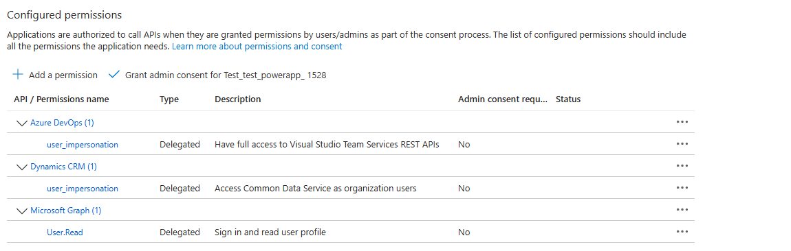

Next, let's add a certificate to our new app user. This is how we will authenticate our connection.

1. Click on **Certificates & secrets** in the navigation blade
1. Click **+ New client secret**
1. Description: add a descriptive note
1. Expires: Recommended: 180 days (6 months)
1. IMPORTANT: note the **client secret value** before navigating away and store it in an easily accessible place. Tip—use Notepad, sticky notes, or OneNote for easy copy/paste later
   - Value:

   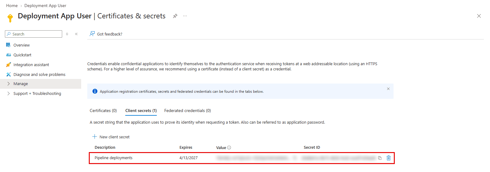

1. Click on the **Overview** tab in the navigation blade
1. Note down **Application (client) ID** and **Directory (tenant) ID**
   - Application (client) ID:
   - Directory (tenant) ID:

   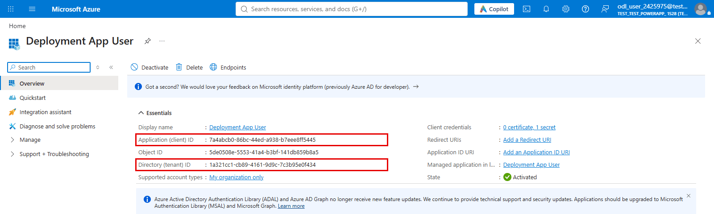

1. Under **Manage**, click **Owners** > **+ Add owners**, search for your lab user, and click **Select**.
1. Go back to **Overview** and click the link under **Managed application in local directory** (Deployment App User). This opens the enterprise application (service principal). Under **Manage**, click **Owners** > **+ Add**, search for your lab user, and click **Select**.

   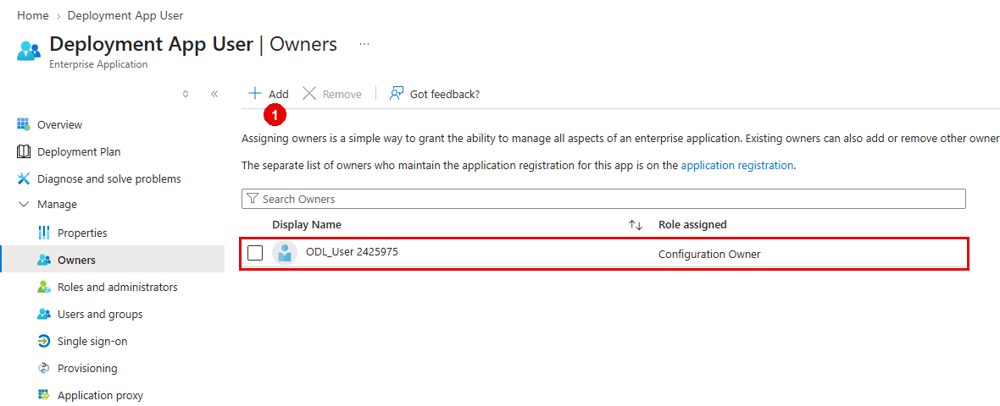

> **IMPORTANT:** The pipeline stage owner (you) must be an owner of the service principal, which is the enterprise application. Being an owner of the app registration alone is not enough: without the enterprise application owner, saving the delegated deployment stage later in this lab fails.

### Create Sharing Security Group

While we are still on the Azure portal, let's create our security group.

1. Navigate to the new group creation page by using this link: https://portal.azure.com/?l=en.en-ie#view/Microsoft_AAD_IAM/AddGroupBlade
1. Use the following group details:
   - **Group Type:** Security
   - **Group Name:** Production App Access Group
1. Click No members selected to add members to the group
   - Search for your own lab user, click **Select**

   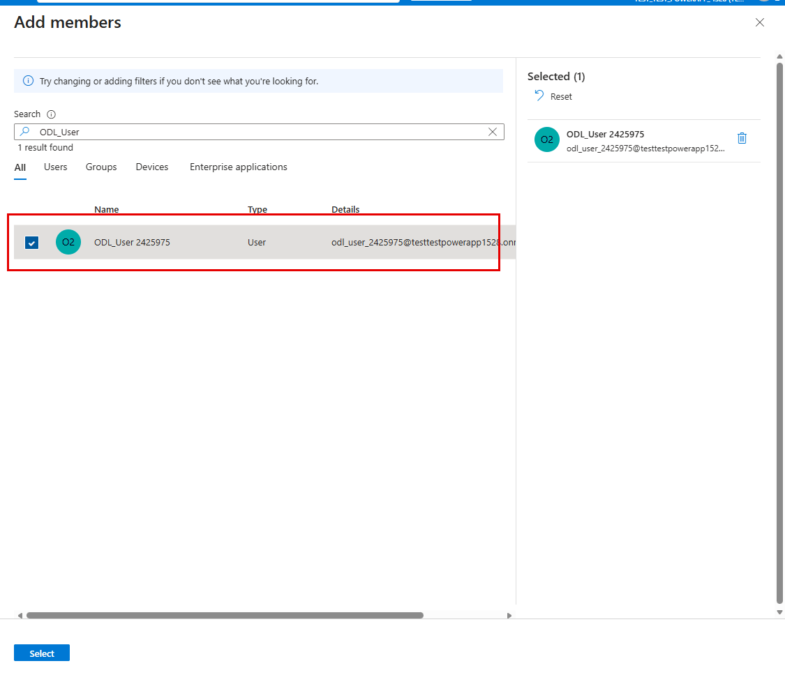

Your group should look like this before clicking **Create**:

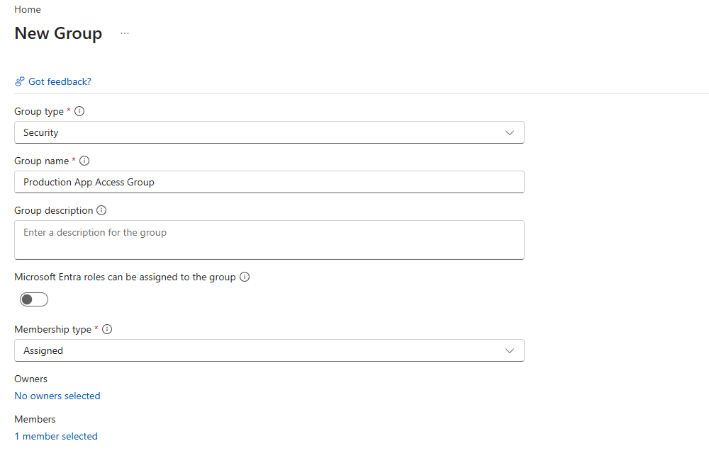

### Create application user in Dataverse

Add Application User to each environment of our pipeline, including the Custom Host Environment

1. Navigate to PPAC at admin.powerplatform.microsoft.com
1. In the Environments tab, select your **Custom Host environment**
1. In the Access section, under S2S apps, click **See all**
1. Click **+ New app user**
1. App: click **+ Add an app** > select the app registration you created in the Create Application User section (you may need to search the name of the App Registration if it is not listed) > click **Add**
1. Business unit: select default BU (type "org" and select the first item)
1. Security roles: System Administrator

   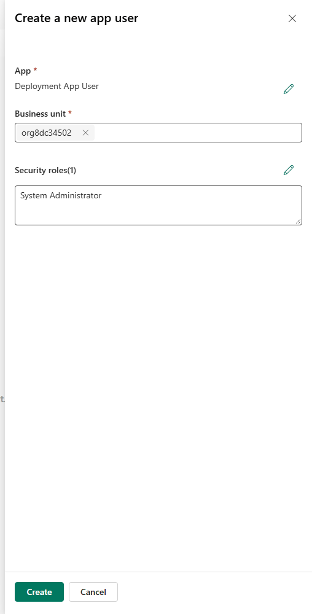

1. Click **Create**
1. Your application user will be listed with a # prefix in the Name column

   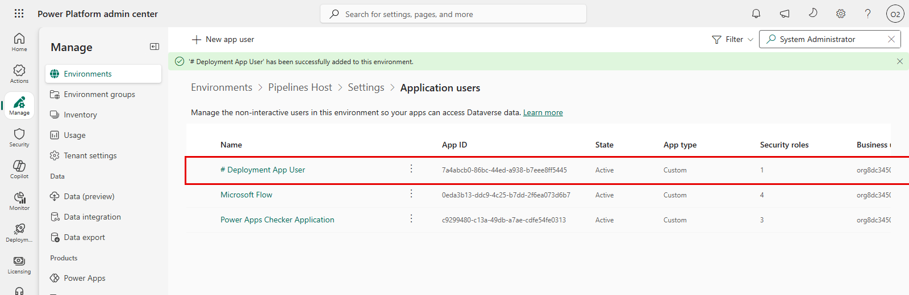

1. Repeat these steps for each of your Dev and Target environments

### Create an approval + SPN delegated deployment flow

**Pathway 1--** For the purposes of this lab, we have provided a complete version of this flow in your lab materials folder. If you are running low on time but would still like to complete this section of the lab, import the [Lab3ApprovalDelegationFlow_1_0_0_1.zip](assets/Lab3ApprovalDelegationFlow_1_0_0_1.zip) solution ("Lab 3.zip" in your lab materials folder) in your Custom Host Environment. After import, jump to **Update Flow after solution import** section.

**Pathway 2 --** If you would like to create the flow manually, follow the steps below.

> **NOTE:** In the instructions below, we have provided the written expression for the dynamic values. You may choose to copy/paste the expressions from the instructions below, or use the lightning bolt icon to add the dynamic values to your flow manually.

1. Navigate back to https://make.preview.powerapps.com/ and select your **Custom Host Environment** from the environment picker dropdown
1. Click **Flows** from the left-hand navigation blade
1. Click **+ New flow** > choose **"Automated flow"** and name your flow "SPN Delegated Deployment Approvals"
1. Select the trigger **"When an action is performed"** from the Dataverse connector.

   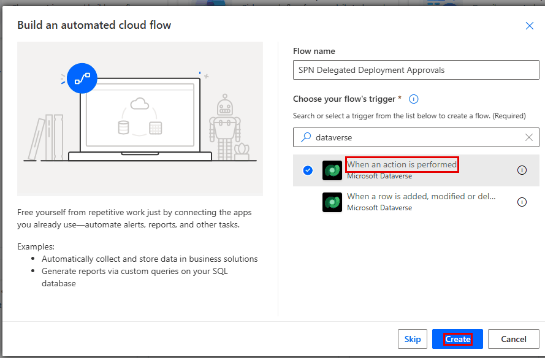

1. Configure the trigger with the following parameters:
   - **Catalog:** Microsoft Dataverse Common
   - **Category:** Power Platform Pipelines
   - **Table Name:** (none)
   - **Action Name:** OnApprovalStarted

   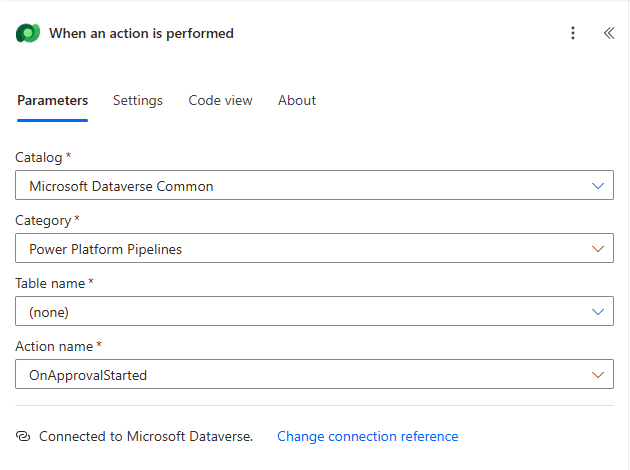

1. Click the three dots and select **Settings**, set the trigger condition to the below parameter. This trigger condition allows us to have a unique flow process for each pipeline. If you'd like to use the same flow for all your pipelines, skip this step:

   ```text
   @equals(triggerOutputs()?['body/OutputParameters/DeploymentPipelineName'], '<<NAME OF THE PIPELINE YOU CREATED IN THE PREVIOUS SECTION>>')
   ```

   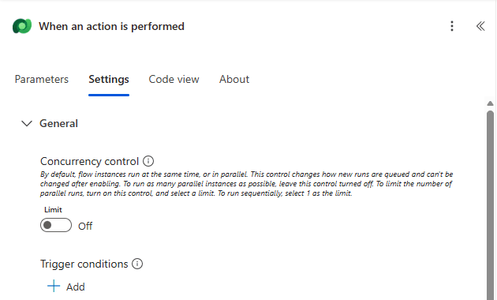

1. Click **+New Step** and search for **"Start and wait for an approval"** in the Standard Approvals connector.

   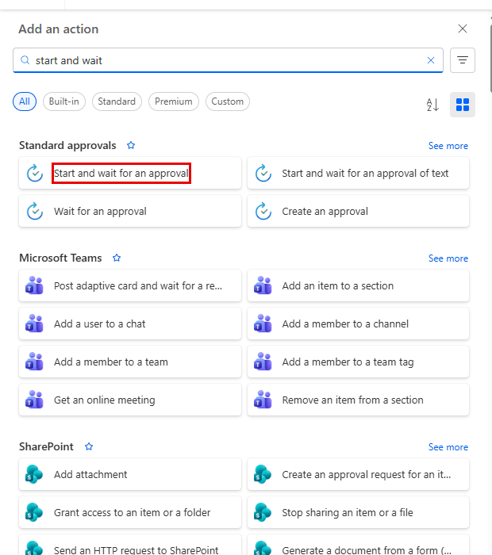

1. Configure the approval with the following parameters (you may copy/paste the parameters):
   - **Approval Type:** Approve/Reject – First to respond
   - **Title:** `Deployment to @{triggerOutputs()?['body/OutputParameters/DeploymentStageName']} requires approval`
   - **Assigned To:** `<<YOUR EMAIL HERE>>`
   - **Details:** Provide the deployment details using the provided markdown format. A sample is provided below:

     ```text
     1. **Requested by:** @{triggerOutputs()?['body/OutputParameters/DeployAsUser']}
     1. **Pipeline:** @{triggerOutputs()?['body/OutputParameters/DeploymentPipelineName']}
     1. **Target environment:** @{triggerOutputs()?['body/OutputParameters/DeploymentStageName']}
     1. **Artifact name:** @{triggerOutputs()?['body/OutputParameters/ArtifactName']}
     1. **Artifact version:** @{triggerOutputs()?['body/OutputParameters/SolutionArtifactVersion']}
     1. **Scheduled time:** @{triggerOutputs()?['body/OutputParameters/ScheduledTime']}
     1. **Download Artifact** @{triggerOutputs()?['body/OutputParameters/UnmanagedArtifactFileDownloadLink']}
     1. **Deployment notes:** @{triggerOutputs()?['body/OutputParameters/AIGeneratedSolutionDescription']}
     ```

   - **Item Link:** `@{triggerOutputs()?['body/OutputParameters/StageRunDetailsLink']}`
   - **Item Link Description:** Stage Link
1. Click **Save draft**

   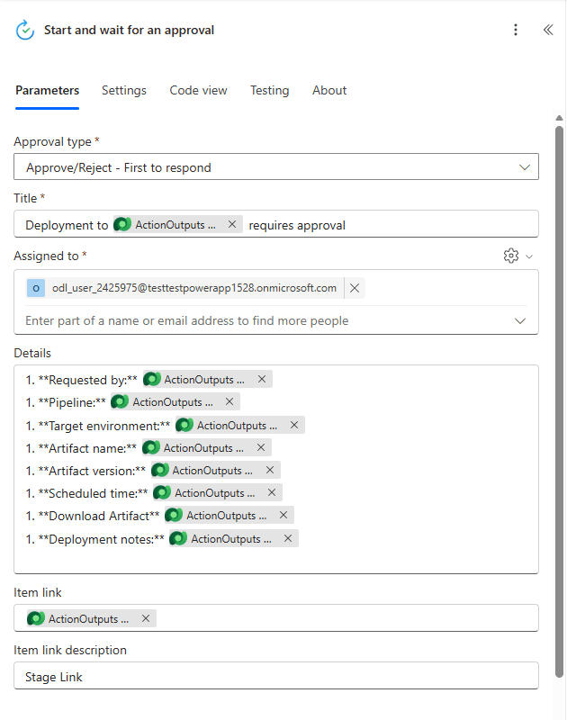

1. Click **+ New step** and add a **condition** to check and add "responses approver response" dynamic variable to the condition. This is the expression parameter: `@items('Apply_to_each')?['approverResponse']` is equal to **Approve**. When you add the Condition parameter, an Apply to each will automatically be added around your condition

   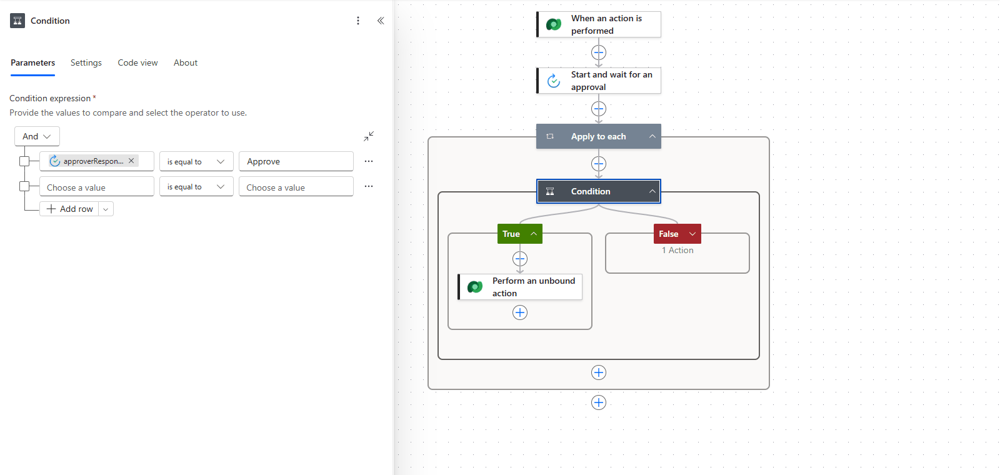

1. In the If yes path, add the **Perform an unbound action** step from the Microsoft Dataverse connector.
1. Configure the true condition with the following parameters:
   - **Action Name:** UpdateApprovalStatus
   - **StageRunId:** `@triggerOutputs()?['body/InputParameters/StageRunId']`
   - **ApprovalProperties:** `@{workflow()}`
   - **ApprovalStatus:** 20

   > **Tip:** Approval Status Step mappings: Pending- **10**, Completed – **20**, Failed – **30**

   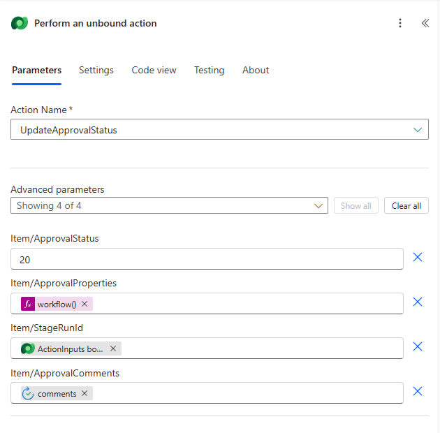

1. In the If no path, add the **Perform an unbound action** step from the Microsoft Dataverse connector.
1. Configure the false condition with the following parameters:
   - **Action Name:** UpdateApprovalStatus
   - **StageRunId:** `@triggerOutputs()?['body/InputParameters/StageRunId']`
   - **ApprovalProperties:** `@{workflow()}`
   - **ApprovalStatus:** 30

   > **Tip:** Approval Status Step mappings: Pending- **10**, Completed – **20**, Failed – **30**

   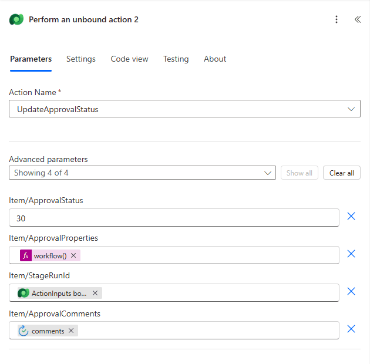

1. Click **Save draft** to save your flow.

**We're not done yet!** Since we will be doing a delegated deployment, we need to configure the flow to use the SPN credentials to execute the approval action using the SPN's connection.

1. Select the **If yes** Dataverse action (Perform an unbound action). At the bottom of the Parameters pane, click **Change connection** (**Change connection reference** in a solution flow), then click **Add new**

   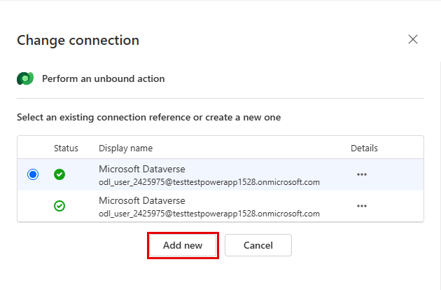

1. Configure the connection:
   - Authentication Type: **Service Principal**
   - Client ID: `<Client ID of the App User you created earlier>`
   - Client Secret: `<Client secret of the App User certificate you created earlier>`
   - Tenant: `<TenantID you saved earlier>`

   > **IMPORTANT:** The Service Principal connection must use the same Client ID as the **SPN Client Id** you set on the delegated deployment stage. If it uses a different app registration, the approval flow fails at Perform an unbound action with the error "Delegated deployments of type 'ServicePrincipal' may only be approved or rejected by the Service Principal configured in the deployment stage." and the deployment stays Awaiting approval.

   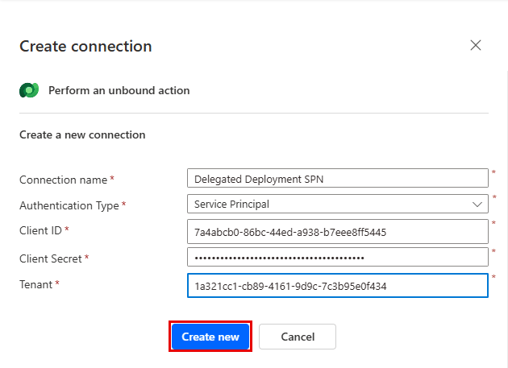

1. Do the same for the If no Dataverse action
1. Click **Publish**. Publishing saves the flow and turns it on.

### Update Flow after solution import

This section is only needed if you used the solution import method to create your flow. If you created the flow yourself, skip this section and continue on to the "Update pipeline to run as delegated" section.

1. After importing your solution, check the following items. If you need help with the steps, refer to the manual flow creation steps above.
   - Ensure the **Trigger Condition** of your flow has the correct Pipeline name. The sample pipeline is configured for "Custom Host Pipeline". Update only if you used a different name for your pipeline. Here is a sample trigger condition:

     ```text
     @equals(triggerOutputs()?['body/OutputParameters/DeploymentPipelineName'], 'Custom Host Pipeline')
     ```

   - **Point the Dataverse connection reference to your SPN connection.** The trigger and both Perform an unbound action steps share one connection reference, so update it in the solution instead of changing each action: open the Lab 3 solution > **Objects** > **Connection references** > **Microsoft Dataverse**. In the **Connection** dropdown, select your Service Principal connection, click **Save**, then click **Save changes**. If you do not have an SPN connection yet, create one first with the Client ID, Client Secret and Tenant ID from your app registration (see the connection steps above).

     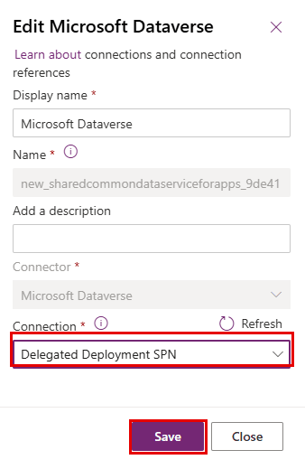

   - **Update the approver.** Open the flow, select the **Start and wait for an approval** step, remove the existing user in **Assigned to**, and add your own lab user. The imported flow is assigned to the original author's account.

     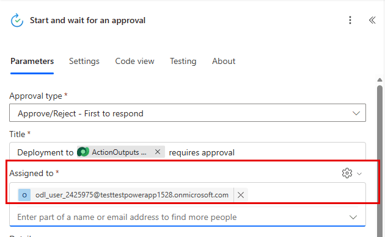

   - **Publish the flow and make sure it is on.** Click **Publish**, then go back to the flow details page and confirm the status is **On**. If it is Off, click **Turn on**.

> **IMPORTANT:** The SPN connection must use the same Client ID as the **SPN Client Id** on the delegated deployment stage. Otherwise, the approval flow fails with "Delegated deployments of type 'ServicePrincipal' may only be approved or rejected by the Service Principal configured in the deployment stage." and the deployment stays Awaiting approval.

### Update pipeline to run as delegated

The flow we just created in the previous section will not trigger until we enable the **Is Delegated Deployment** gated extension in the pipeline configuration. Now, let's configure our pipeline to initiate the flow.

1. Return to the **Pipeline Host** environment, and launch the **Deployment Pipeline Configuration** app
1. Click on the **Pipelines** tab
1. Open the pipeline you created earlier (Custom Host Pipeline) by clicking on its name
1. In the **Deployment Stages (Deployment pipeline)** grid, open the first stage in your pipeline. This will be the stage with a blank value in the Previous Deployment Stage column.
1. On the deployment stage record form, check the box next to **Is Delegated Deployment**
   - Select **Service Principal** for Delegated Deployment Type
   - For SPN Client Id, provide the **client ID** of the app user you created earlier
   - Allow sharing requests: **Yes**

   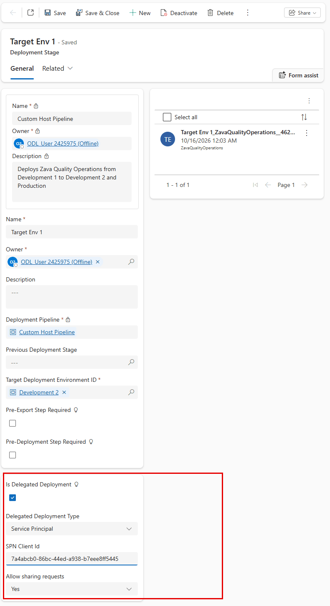

1. Click **Save & Close**

### Run SPN delegated pipeline

You may want to test your deployment at this stage. Go to your Dev environment, and trigger a deployment. After the usual validation, you will see an additional step called **Share** which we didn't see when deploying using the Platform Host pipeline. This step will allow us to share objects within the Target environment directly from your Pipeline deployment. The Share step only appears when the deployment includes objects that are new to the target environment, such as the first deployment of the solution to that stage. While the Zava Quality Operations solution doesn't have any connection references or environment variables, if the solution contains either, you'd see additional steps called "Connections" and "environment variables" respectively.

After the **Select deployment target** step, we see the Share step:

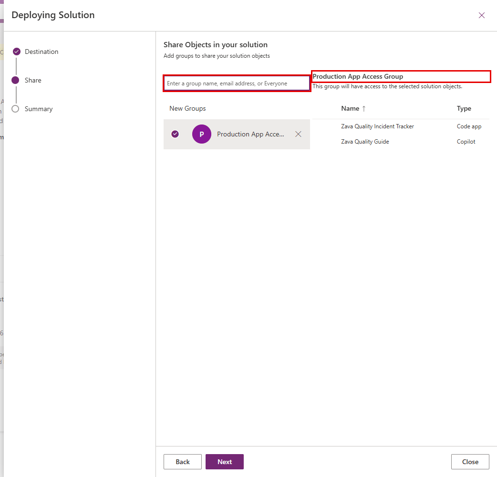

1. Search for **Production App Access** in the enter a group name box
1. Select **Production App Access Group**. The group will have access to the selected solution objects: **Zava Quality Incident Tracker** (Code app) and **Zava Quality Guide** (Copilot). There is no security role to select.
1. Click **Next**, then click **Deploy** on the next page. The Deployment stage will look like this as the pipeline waits for the approval process to complete:

   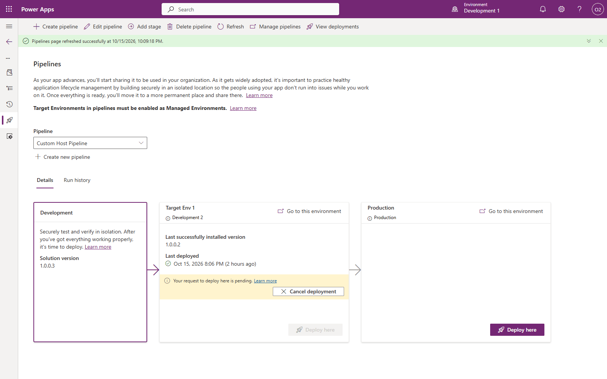

For the purpose of this lab, we will use the **Deployment** page in the Power Platform admin center (PPAC) to grant the approval. Normally, you have the option to pick from Teams, Outlook, or Power Automate portal to review the approval request.

1. Navigate to https://admin.powerplatform.microsoft.com/ and click **Deployment** on the left navigation blade
1. On the **Overview** tab, select your custom host in the host dropdown (for example, **Custom host: Pipelines Host**)
1. Under Pipelines activity, the **Pending approvals** tile shows your pending approval, and the request is listed in the table below it

   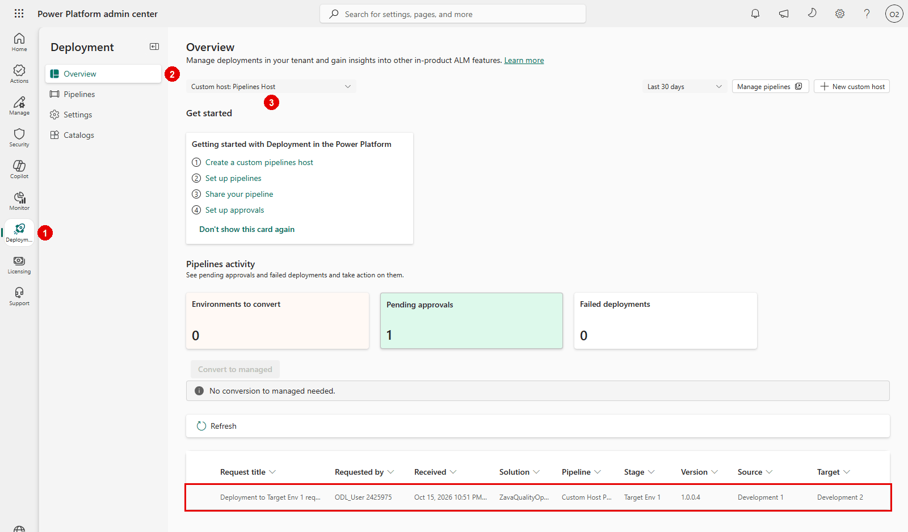

1. Click on the request to review it. The **Approval request** pane will appear on the right hand side of the screen. Optionally add a comment, then choose **Approve** here:

   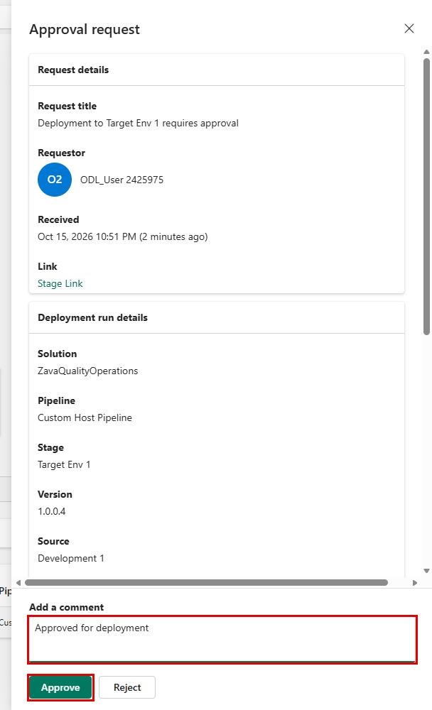

1. Check back on your pipeline after receiving the approval. Your deployment stage will update with "Currently deploying version #.#.#.#"

   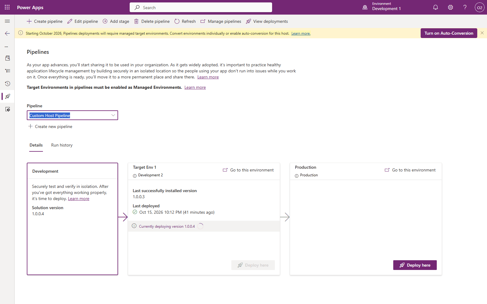

1. Once complete, click on the **Go to this environment** hyperlink on the deployment stage
1. Click on **Apps** in the left-hand navigation
1. Select **Shared with me**
1. Verify that **Zava Quality Incident Tracker** is listed. Its owner is **Deployment App User** because the deployment ran as the service principal.
1. Because the app was shared with the **Production App Access Group** during deployment, members of the group (including you) can open it from here.

   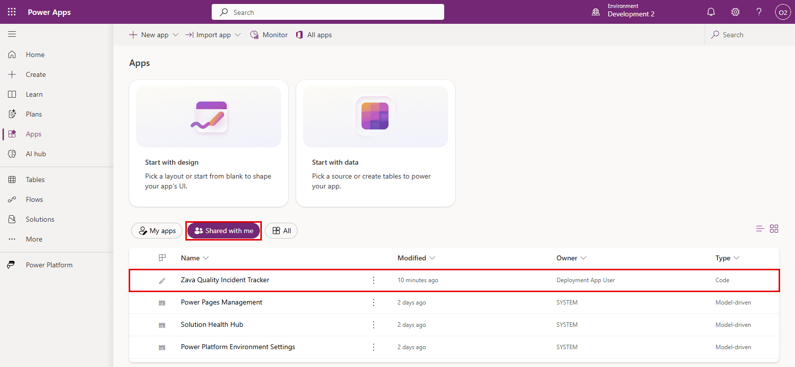

---

## 🔄 Task 4 - Redeploy a prior version

**Prerequisite:** If you didn't complete Task 3, submit another deployment now. Run History should have at least two deployed versions.

While delegated deployments and approvals reduce the chances of breaking applications in production, mistakes can and do happen.

Let's pretend the last deployment contained a critical breaking change and it needs to be rolled back. In this task, you'll re-deploy the last known good version of your solution.

1. Open the maker portal (https://make.preview.powerapps.com/) and make sure you are in your development environment
1. Open **Solutions** from the left hand navigation blade
1. Open the unmanaged solution (Zava Quality Operations) that you deployed using the pipeline earlier in this lab
1. Select **Pipelines** > click on the **Run History** tab

   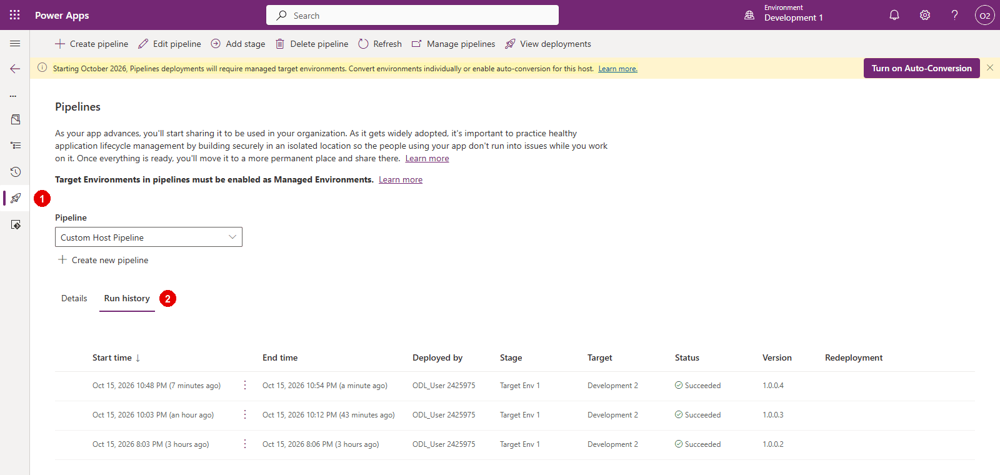

1. Select the lower version, then **Re-deploy** from the menu.

   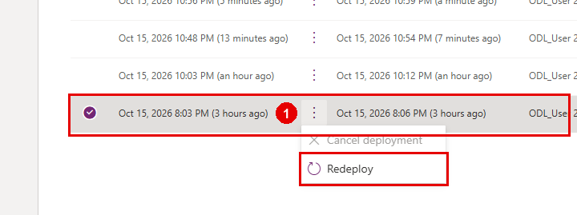

1. Select **Redeploy** in the confirmation popup

   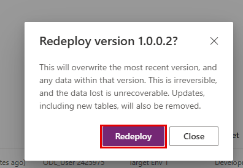

1. When the deployment panel opens, click Next until you get to the last screen, then **Deploy**. See prior Task for detailed steps if needed.
1. In a new tab, open the **Deployment** page in the Power Platform admin center again and **Approve** the deployment request
1. Deployment is now in-progress. Wait until it finishes. You may need to refresh the pipelines page.
1. Disaster averted! Now the prior version is deployed to production and you have time to fix the (hypothetical) issue and deploy an updated version when ready.

---

## 📎 Appendix

### Steps to enable Managed Environments

1. Navigate to Power Platform Admin Center (PPAC) at https://admin.powerplatform.microsoft.com/manage/environments
1. In the Manage tab on the left hand side, click on **Environments**
1. Select the environment where you want to enable Managed Environments
1. In the ribbon, click **Enable Managed Environments**
1. Click **Enable** in the fly out wizard

   

1. Repeat steps 3-5 for any other environments where you need to enable Managed Environments.
